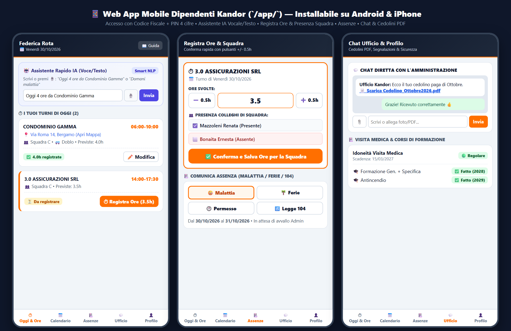

# KANDOR - Guida Operativa Completa per il Dipendente
## Web App Mobile (`/app/`) & Bot Telegram (`@kandor_gestionale_bot`)

**Versione 3.3 — 13 Novembre 2026**  
*Manuale Passo-Passo per la Registrazione Ore, Timbratura GPS/QR Code, Consultazione Turni, Richiesta Assenze, Ordine Materiali Cantiere, Segnalazioni e Scarico Buste Paga PDF*

---

## INTRODUZIONE GENERALE E DESCRIZIONE DI TUTTE LE FUNZIONI PER IL DIPENDENTE

### Cosa sono gli Strumenti Digitali Kandor per il Lavoratore
Per rendere il lavoro quotidiano semplice, veloce e trasparente, **Kandor** mette a disposizione di ogni lavoratore due strumenti gratuiti utilizzabili direttamente dal proprio smartphone, perfettamente sincronizzati tra loro in tempo reale:

1. **La Web App Mobile Kandor (`https://kandor.187.126.30.207.sslip.io/app/`)**  
   Una vera applicazione per cellulare (Android e iPhone) che si apre con un tocco dall'icona sulla schermata Home del telefono, senza occupare memoria e senza dover scaricare nulla dal Play Store o dall'App Store.
2. **L'Assistente Bot Telegram (`@kandor_gestionale_bot`)**  
   Un assistente automatico attivo 24 ore su 24 dentro l'app **Telegram** che permette di compiere tutte le operazioni giornaliere semplicemente premendo comodi bottoni guidati nella chat.

> **Posso usare sia la Web App che Telegram?**  
> **Si!** I due strumenti sono collegati allo stesso archivio centrale: se registri le ore su Telegram, le vedrai subito compilate anche nella Web App (e viceversa). Puoi scegliere liberamente quale usare in ogni momento.

---

### Elenco Completo di Tutto Cio che Puoi Fare dal Tuo Smartphone

Ecco in sintesi tutte le funzioni spiegate passo dopo passo in questo manuale:

1. **⏱ Registrazione Ore del Giorno (con 1 solo tocco)**: confermi le ore previste per i tuoi cantieri di oggi oppure inserisci l'orario effettivamente svolto.
2. **💬 Motivazione Automatica per Ore Diverse dal Previsto**: se in un cantiere hai lavorato **meno ore** o **piu ore** rispetto a quelle previste dal tuo turno, il sistema ti chiede di scrivere brevemente il motivo (es. *"Finito 30 minuti prima per uffici chiusi"* o *"1 ora in piu per pulizia straordinaria scale"*), cosi l'ufficio paghe ha subito tutte le informazioni corrette.
3. **📋 Recupero Turni da Compilare (fino a 31 Giorni indietro)**: visualizzi in un unico elenco tutti i turni degli **ultimi 31 giorni** che hai dimenticato di compilare (evidenziati con il pallino rosso 🔴) e li completi in pochi secondi.
4. **📍 Timbratura Check-In / Check-Out con GPS e QR Code in Cantiere**: quando arrivi in cantiere puoi inquadrare il **Cartello QR Code Kandor** (o premere **`Check-In GPS`** nella Web App) e a fine turno premere **`Check-Out GPS`** per far calcolare automaticamente le ore lavorate.
5. **📅 Calendario Personale e Compagni di Squadra**: controlli i tuoi turni di oggi, domani e di tutta la settimana, vedi l'indirizzo esatto del cantiere (con apertura diretta in **Google Maps**) e vedi chi sono i tuoi compagni di squadra e se hanno gia segnato le ore.
6. **🏥 Invio Richieste di Assenza (`Malattia`, `Ferie`, `Permesso`, `Legge 104`)**: comunichi in pochi tocchi un'assenza giornaliera o un permesso orario e inserisci il numero di protocollo del certificato medico INPS (PUC).
7. **🧴 Richiesta Materiali e Prodotti per il Cantiere (`Richiedi Materiali`)**: quando in un cantiere sta finendo un detergente, la carta, i sacchi o un attrezzo, invii l'ordine direttamente al Magazzino scegliendo il cantiere e il prodotto dal menu.
8. **📄 Consultazione e Scarico Buste Paga in PDF (`Buste Paga`)**: visualizzi l'elenco di tutte le tue buste paga mensili e scarichi il file **PDF ufficiale** direttamente dentro Telegram o nella Web App ogni volta che ti serve (anche per banca, CAF o730).
9. **🔄 Accettazione o Rifiuto Proposte di Sostituzione**: quando l'ufficio cerca un sostituto per coprire un turno extra, ricevi la proposta sul telefono e puoi accettarla con un solo tocco (`✅ Accetto`).
10. **🚨 Segnalazioni dal Cantiere, Chat con l'Ufficio e Foto Profilo**: segnali guasti o problemi riscontrati presso il cliente, scrivi direttamente ai Responsabili e aggiorni la tua foto profilo per il tesserino aziendale.

---

## PARTE 1 — ACCESSO E INSTALLAZIONE SULLO SMARTPHONE

### 1.1 Come Accedere alla Web App Mobile (`/app/`) Passo-Passo
Per entrare nella Web App ti servono solo due dati personali:
- Il tuo **Codice Fiscale** (16 caratteri, es. `RSSMRA80A01A794Z`);
- Il tuo **PIN Personale a 4 cifre** (consegnato dall'ufficio o ricevuto via WhatsApp).

**Procedura passo dopo passo:**
1. Apri il browser del tuo telefono (**Chrome** su Android oppure **Safari** su iPhone) e vai all'indirizzo:  
   **`https://kandor.187.126.30.207.sslip.io/app/`**  
   *(Oppure tocca direttamente il **Link Personale WhatsApp** che ti ha inviato l'ufficio: in quel caso entrerai subito senza nemmeno dover digitare Codice Fiscale e PIN!)*
2. Nella schermata di accesso inserisci:
   - Nel primo campo: il tuo **Codice Fiscale**;
   - Nel secondo campo: il tuo **PIN a 4 cifre**.
3. Tocca il pulsante arancione **`Accedi all'App`**.
4. Il tuo telefono **ricordera automaticamente l'accesso per 90 giorni**: le volte successive si aprira subito la tua pagina personale senza chiederti di nuovo la password.

### 1.2 Come Salvare l'Icona dell'App Kandor sulla Schermata Home del Telefono
Per aprire Kandor con un solo tocco come una normale app del telefono:
- **Su Android (Google Chrome)**:
  1. Una volta aperta la pagina `/app/`, tocca il pulsante **`📲 Installa App sul Telefono`** se compare in alto, oppure tocca i **tre puntini `⋮`** in alto a destra in Chrome;
  2. Seleziona **`Aggiungi a schermata Home`** (o **`Installa applicazione`**) e conferma su **`Aggiungi`**.
- **Su iPhone (Safari)**:
  1. Apri `https://kandor.187.126.30.207.sslip.io/app/` con **Safari**;
  2. Tocca l'icona **Condividi** in basso al centro (il quadratino con la freccia rivolta verso l'alto `⬆️`);
  3. Scorri il menu e tocca **`Aggiungi alla schermata Home`**, poi tocca **`Aggiungi`** in alto a destra.

---

### 1.3 Come Collegare per la Prima Volta il Bot Telegram (`@kandor_gestionale_bot`)
Se preferisci usare **Telegram**, il primo collegamento richiede meno di 30 secondi:

1. Apri l'applicazione **Telegram** sul tuo smartphone.
2. Nella barra di ricerca in alto scrivi **`@kandor_gestionale_bot`** (oppure **Kandor Assistente**) e apri la chat con il Bot ufficiale.
3. Tocca il pulsante **`AVVIA`** (oppure scrivi **`/start`** e invia il messaggio).
4. **Passo 1 — Inserimento Codice Fiscale**:
   - Il Bot ti rispondera: *"👋 Benvenuto in Kandor ERP! Per collegare il tuo telefono in sicurezza, scrivi qui sotto il tuo CODICE FISCALE (16 caratteri)."*
   - Scrivi il tuo **Codice Fiscale** e invia il messaggio.
5. **Passo 2 — Inserimento PIN a 4 cifre**:
   - Il Bot verifichera il tuo Codice Fiscale e ti chiedera: *"🔐 Ottimo! Ora scrivi il tuo PIN personale a 4 cifre per completare l'attivazione."*
   - Scrivi il tuo **PIN a 4 cifre** e invia il messaggio.
6. **Conferma Attivazione**:
   - Il Bot confermera il collegamento con il messaggio **`✅ Accreditamento completato con successo!`** e aprira subito il **Menu Principale** con tutti i bottoni operativi.
   - Da questo momento in poi il tuo telefono e riconosciuto per sempre: ti bastera toccare i bottoni del menu!

### 1.4 Protezione di Sicurezza Anti-Duplicato (Cosa succede se cambi telefono)
- **Regola di sicurezza**: ogni profilo dipendente puo essere collegato a **un solo telefono Telegram alla volta**. Se una seconda persona o un altro telefono prova a inserire il tuo Codice Fiscale, il sistema **blocca automaticamente il secondo telefono** per proteggere i tuoi dati e le tue buste paga.
- **Hai cambiato smartphone o numero Telegram?** Avvisa semplicemente l'ufficio: il responsabile azzerera il vecchio collegamento nella tua scheda e potrai fare `/start` dal tuo nuovo telefono.

---

## PARTE 2 — IL MENU PRINCIPALE DEL BOT TELEGRAM E DELLA WEB APP

Quando apri il **Bot Telegram (`@kandor_gestionale_bot`)** (o premi il pulsante `Menu` / `↩ Menu Principale`), trovi sempre questa pulsantiera ordinata:

| Pulsante sul Bot Telegram | Corrispondente nella Web App (`/app/`) | A cosa serve |
|---|---|---|
| **⏱ Registra Ore** | Tab **Oggi** | Segnare le ore lavorate nei cantieri di oggi |
| **📅 Calendario** | Tab **Calendario** | Vedere i turni di ieri, oggi, domani e della settimana |
| **📋 Turni da compilare** | Tab **Da Compilare (31gg)** | Recuperare i turni passati rimasti senza ore negli ultimi 31 giorni |
| **Malattia** / **Ferie** | Tab **Assenze** | Inviare una comunicazione di malattia o una richiesta di ferie |
| **Permesso** / **Legge 104** | Tab **Assenze** | Richiedere un permesso orario/giornaliero o Legge 104 |
| **🧴 Richiedi Materiali Cantiere** | Tab **Materiali** | Ordinare prodotti o detergenti che stanno finendo in cantiere |
| **🚨 Segnalazione** | Tab **Segnalazioni** | Segnalare un guasto, un imprevisto o una nota dal cantiere |
| **📄 Buste Paga** | Tab **Buste Paga** | Scaricare sul telefono le proprie buste paga in formato PDF |
| **📸 Foto Profilo** | Icona **Foto in alto** | Scattare o caricare la propria foto per il tesserino aziendale |
| **📖 Guida** | Link **Guida** | Aprire questo manuale operativo sempre aggiornato |

---

## PARTE 3 — COME REGISTRARE LE ORE LAVORATE E INSERIRE LA MOTIVAZIONE

### 3.1 Procedura Passo-Passo per Registrare le Ore di OGGI su Telegram (`⏱ Registra Ore`)
1. Nel Menu Principale del Bot Telegram tocca il pulsante **`⏱ Registra Ore`**.
2. Il Bot ti mostra l'elenco dei tuoi turni programmati per **oggi** (es. `Condominio Verdi (06:00-09:00)`).
   - Se un turno ha gia il simbolo **`✅`** davanti al nome, significa che le ore di quel turno sono gia state registrate.
3. Tocca il nome del cantiere per cui vuoi registrare le ore.
4. Il Bot ti mostra il riepilogo del turno (Cliente, Orario previsto e Ore previste da contratto, es. `3.0 ore`) e ti propone le scelte rapide:
   - **Caso A — Hai fatto esattamente le ore previste**: tocca il pulsante **`✅ Conferma 3.0 ore (Previste)`** (oppure il bottone corrispondente alle tue ore). Le ore vengono salvate immediatamente!
   - **Caso B — Hai fatto un numero di ore DIVERSO da quello previsto** (es. mezz'ora in meno o un'ora in piu):
     1. Tocca il bottone con il numero di ore effettivamente svolte (es. `2.5h` o `4.0h`) oppure tocca **`✏️ Altro (Scrivi ore)`** e digita il numero (es. `3.5`);
     2. **Richiesta automatica della Motivazione**: poiche le ore inserite sono diverse da quelle previste dal turno, il Bot ti chiedera:  
        *"📝 Hai indicato X ore invece delle Y previste. Scrivi brevemente il MOTIVO della variazione (es. lavoro extra richiesto, uscita anticipata, ecc.):"*
     3. Scrivi un breve messaggio con il motivo (es. *"Rimasta 1 ora in piu per pulire vetri portineria dopo lavori murari"*) e premi **Invia**;
     4. Il Bot salvera sia le ore sia la tua nota, che sara subito visibile con l'icona **`💬`** sul calendario dell'ufficio!

### 3.2 Come Recuperare i Turni Dimenticati degli Ultimi 31 Giorni (`📋 Turni da compilare`)
Se ieri o nelle settimane scorse hai dimenticato di segnare le ore di uno o piu cantieri:
1. Dal Menu Principale tocca il pulsante **`📋 Turni da compilare`** (oppure nella Web App `/app/` apri il tab **`Da Compilare`**).
2. Il sistema controlla tutti i tuoi turni degli **ultimi 31 giorni** e ti elenca solo quelli in cui mancano ancora le tue ore, contrassegnati dal pallino rosso **`🔴 GG/MM Nome Cliente (Orario)`**.
   - Se non hai nessun arretrato, vedrai la scritta **`✅ Tutto compilato!`**.
3. Tocca il turno con il pallino rosso **`🔴`**, conferma le ore previste (oppure inserisci le ore effettive + la motivazione) e il turno scomparira subito dalla lista degli arretrati!

### 3.3 Come Registrare le Ore dalla Web App Mobile (`/app/`)
1. Apri la Web App `/app/`: nella schermata iniziale (**Oggi**) vedi subito le schede dei tuoi cantieri della giornata.
2. In ogni scheda cantiere vedi:
   - Il nome del cliente e l'indirizzo (cliccabile per aprire **Google Maps**);
   - L'orario previsto e i **nomi dei tuoi compagni di squadra** (con il pallino verde se hanno gia segnato le ore);
   - La casella con le ore previste gia precompilata.
3. Se hai svolto l'orario previsto, tocca semplicemente il pulsante verde **`✅ Conferma Ore`**.
4. Se invece modifichi il numero di ore nella casella inserendo un valore diverso dal previsto, comparira automaticamente il campo obbligatorio **`📝 Motivo variazione orario`**: scrivi il motivo e tocca **`💾 Salva Ore`**.

---

## PARTE 4 — TIMBRATURA CHECK-IN / CHECK-OUT CON GPS E QR CODE CANTIERE

In tutti i cantieri dotati di **Cartello QR Code Kandor** (o direttamente dalla Web App `/app/`), puoi registrare l'orario esatto di inizio e fine lavoro con verifica GPS:

### 4.1 Come Funziona il Check-In (Arrivo in Cantiere) e il Check-Out (Fine Lavoro)
1. **Quando arrivi sul posto di lavoro**:
   - Inquadra con la fotocamera del telefono il **Cartello QR Code** affisso nel locale pulizie del cantiere (oppure apri la Web App `/app/` sulla scheda del cantiere di oggi);
   - Tocca il pulsante verde **`🟢 Check-In GPS (Inizio Lavoro)`** (acconsentendo, se richiesto dal telefono, alla posizione GPS);
   - Il sistema verifica che ti trovi presso il cantiere (entro 300 metri) e registra l'ora esatta di entrata (es. `🟢 Check-In registrato alle 06:02`).
2. **Quando hai terminato il turno**:
   - Riapri la Web App `/app/` (o inquadra nuovamente il QR Code) e tocca il pulsante rosso **`🔴 Check-Out GPS (Fine Lavoro)`**;
   - Il sistema registra l'ora di uscita, calcola automaticamente le ore lavorate e le salva nel tuo cartellino!

---

## PARTE 5 — CONSULTARE IL CALENDARIO TURNI (`📅 Calendario`)

### 5.1 Come Vedere i Turni di Oggi, Domani e dei Prossimi Giorni
- **Su Bot Telegram**:
  1. Tocca **`📅 Calendario`** nel Menu Principale;
  2. Vedrai tutti i tuoi turni del giorno con **Cantiere**, **Indirizzo**, **Fascia Oraria**, **Squadra** e stato di compilazione delle ore;
  3. Usa i due bottoni sotto il messaggio (**`⬅️ Precedente`** e **`Successivo ➡️`**) per sfogliare comodamente i giorni successivi o precedenti.
- **Sulla Web App (`/app/`)**:
  1. Tocca l'icona **`📅 Calendario`** nella barra inferiore;
  2. Scorri la vista settimanale completa con tutti i tuoi turni passati e futuri.

---

## PARTE 6 — COMUNICARE MALATTIA, FERIE, PERMESSI E LEGGE 104

### 6.1 Come Comunicare una MALATTIA e il Codice Certificato INPS (PUC)
1. Dal Menu Principale del Bot Telegram tocca **`Malattia`** (oppure nella Web App vai nel tab **`Assenze`** e scegli **`Malattia`**).
2. Seleziona o digita la **Data di Inizio Malattia** e la **Data di Fine Malattia** (secondo quanto indicato dal medico).
3. Inserisci il **Numero di Protocollo del Certificato Medico INPS (PUC)** (se sei appena andato dal medico o sei in attesa del numero, puoi inviare subito l'avviso di malattia e comunicare il numero di protocollo appena il medico te lo rilascia).
4. Conferma l'invio: l'ufficio riceve istantaneamente l'avviso e provvede a sostituirti nei cantieri scoperti.

### 6.2 Come Richiedere FERIE
1. Dal Menu Principale tocca **`Ferie`**.
2. Indica la **Data del primo giorno di ferie** e la **Data dell'ultimo giorno di ferie** (oppure lo stesso giorno se chiedi un solo giorno).
3. Aggiungi un'eventuale nota e invia la richiesta: nella Web App potrai vedere quando la richiesta passa dallo stato *In attesa* allo stato **`✅ Approvata / Avvallata`**.

### 6.3 Come Richiedere un PERMESSO (Giornaliero o Orario) o LEGGE 104
1. Dal Menu Principale tocca **`Permesso`** (oppure **`Legge 104`**, visibile automaticamente se ne hai diritto).
2. Scegli se ti serve:
   - **Giornata Intera** (indicando data inizio e data fine);
   - **Permesso Orario** (indicando il **Giorno**, l'**Ora di inizio**, l'**Ora di fine** e il **Numero di ore** di permesso, es. dalle `08:00` alle `10:00` = `2 ore`).
3. Scrivi una breve nota motivazionale e conferma l'invio.

---

## PARTE 7 — RICHIEDERE MATERIALI E PRODOTTI PER IL CANTIERE (`🧴 Richiedi Materiali`)

Non aspettare che un prodotto finisca completamente: appena vedi che in uno sgabuzzino sta terminando il detergente, i sacchi o la carta, ordinalo dal telefono!

### 7.1 Procedura Passo-Passo (da Bot Telegram o da Web App `/app/`)
1. **Da Bot Telegram**:
   - Dal Menu Principale tocca il pulsante **`🧴 Richiedi Materiali Cantiere`**;
   - **Passo 1**: seleziona dalla lista il **Cantiere / Cliente** dove manca il materiale (ti vengono proposti subito i cantieri in cui lavori abitualmente);
   - **Passo 2**: tocca il **Prodotto** che ti serve dalla lista del magazzino (es. *Detergente Pavimenti*, *Sgrassatore*, *Anticalcare Bagni*, *Alcool Vetri*, *Sacchi Neri*, *Guanti*, *Panni Microfibra*) oppure scegli *Altro prodotto* e scrivi cosa serve;
   - **Passo 3**: indica la **Quantita** (es. `2` flaconi) ed eventuale nota d'urgenza.
2. **Dalla Web App (`/app/`)**:
   - Apri il tab **`🧴 Materiali`**, scegli il **Cantiere**, il **Prodotto**, la **Quantita** e l'**Urgenza** (`Normale` o `Urgente`) e tocca **`📦 Invia Richiesta al Magazzino`**.
3. La tua richiesta arriva in tempo reale nella sezione **Magazzino (`/magazzino-dotazioni/`)** dell'ufficio per la preparazione della consegna!

---

## PARTE 8 — SCARICARE E CONSULTARE LE PROPRIE BUSTE PAGA IN PDF (`📄 Buste Paga`)

Con Kandor hai sempre tutte le tue **Buste Paga in formato PDF** archiviate sul telefono, pronte da aprire, salvare o stampare in qualsiasi momento senza doverle richiedere in ufficio.

### 8.1 Come Scaricare la Busta Paga dal Bot Telegram (`📄 Buste Paga`)
1. Apri la chat con **`@kandor_gestionale_bot`** e dal Menu Principale tocca il pulsante **`📄 Buste Paga`**.
2. Il Bot ti mostra la lista delle tue ultime buste paga disponibili (es. **`📥 Ottobre 2026`**, **`📥 Settembre 2026`**, **`📥 Agosto 2026`**).
3. **Tocca il mese che desideri**: entro 1 secondo il Bot ti inviera direttamente nella chat il **file PDF originale della tua busta paga** (`Busta_Paga_Cognome_Nome_Mese_Anno.pdf`), pronto da aprire sul telefono, salvare nei documenti o inoltrare!
4. Inoltre, ogni mese, non appena l'ufficio carica le nuove buste paga, riceverai automaticamente il PDF del nuovo mese direttamente su Telegram.

### 8.2 Come Scaricare la Busta Paga dalla Web App Mobile (`/app/`) o da WhatsApp
1. Apri la Web App `https://kandor.187.126.30.207.sslip.io/app/` e tocca la voce **`📄 Buste Paga`** nel menu.
2. Vedrai l'elenco cronologico di tutti i tuoi cedolini mensili con la data di pubblicazione.
3. Tocca il pulsante **`📥 Scarica PDF`** accanto al mese desiderato per aprire subito il documento PDF sul tuo telefono.
4. Se l'ufficio ti invia la busta paga su **WhatsApp**, ti basta toccare il link sicuro contenuto nel messaggio per scaricare immediatamente il tuo PDF personale.

---

## PARTE 9 — SEGNALAZIONI, SOSTITUZIONI, CHAT CON L'UFFICIO E FOTO PROFILO

### 9.1 Inviare una Segnalazione dal Cantiere (`🚨 Segnalazione`)
Se trovi un guasto in un condominio (es. una lampadina bruciata, una perdita d'acqua, una serratura rotta o un macchinario che non funziona):
1. Tocca **`🚨 Segnalazione`** nel Menu Principale di Telegram (o apri il tab **Segnalazioni** nella Web App `/app/`);
2. Scrivi il messaggio specificando il cantiere e il problema riscontrato (nella Web App puoi anche allegare una **foto del problema**);
3. Il motore intelligente classifica subito l'urgenza e avvisa immediatamente la tua Responsabile d'Area!

### 9.2 Usare l'Assistente Vocale / Testuale Intelligente
Sia su Telegram sia nella barra **Assistente IA** della Web App puoi anche scrivere (o dettare con il microfono della tastiera) una frase normale, ad esempio:
- *"Oggi 3 ore da Condominio Rossi"* → registra automaticamente le 3 ore sul turno di oggi;
- *"Domani sono in malattia"* → avvia subito la registrazione della malattia per domani.

### 9.3 Accettare una Proposta di Sostituzione (Turni Extra)
Quando un collega e assente e il sistema ti individua come possibile sostituto compatibile:
1. Ricevi un messaggio su Telegram (e un avviso in cima alla Web App `/app/`) con scritto: **Cantiere, Indirizzo, Data e Orario del turno da coprire**;
2. Se sei disponibile a svolgere il turno, tocca **`✅ Accetto Sostituzione`**;
3. Se sei il primo ad accettare, il turno viene aggiunto automaticamente al tuo Calendario e ricevi subito il messaggio di conferma!

### 9.4 Caricare o Aggiornare la propria Foto Profilo (`📸 Foto Profilo`)
1. Tocca **`📸 Foto Profilo`** nel Menu Principale di Telegram (oppure tocca il cerchio con le tue iniziali in alto a sinistra nella Web App `/app/`);
2. Scatta un selfie o scegli una foto chiara del tuo viso dalla galleria del telefono e inviala;
3. La tua foto verra salvata automaticamente sulla tua scheda dipendente e nella Web App.

---

## PARTE 10 — DOMANDE FREQUENTI DEI DIPENDENTI (FAQ RAPIDE)

- **D: Non ricordo il mio PIN a 4 cifre per entrare nell'App o su Telegram. Come faccio?**  
  **R:** Chiedi alla tua Responsabile d'Area o in ufficio: possono leggere il tuo PIN nella tabella Dipendenti o inviarti su WhatsApp il tuo **Link Personale di Accesso Diretto**.

- **D: Ho sbagliato a inserire le ore di un cantiere di oggi. Posso correggerle?**  
  **R:** Si! Finche l'ufficio non ha ancora bloccato il mese per le paghe, ti basta rientrare in **`⏱ Registra Ore`** (o nella scheda del turno sulla Web App `/app/`), selezionare di nuovo lo stesso cantiere e inserire il numero di ore corretto (indicando il motivo se l'orario e diverso dal previsto).

- **D: Perche il Bot mi chiede di scrivere un motivo dopo che ho segnato le ore?**  
  **R:** Te lo chiede solo quando il numero di ore che hai indicato e **diverso** (piu basso o piu alto) rispetto alle ore previste per quel turno. E una tutela anche per te: scrivendo il motivo (es. *"1 ora extra per pulizia vetri"*), l'ufficio sa subito perche hai fatto piu ore e puo riconoscertele correttamente in busta paga.

- **D: Dove trovo questo manuale se ho un dubbio mentre sono al lavoro?**  
  **R:** Tocca in qualsiasi momento il pulsante **`📖 Guida`** in fondo al Menu Principale del Bot Telegram oppure apri `https://kandor.187.126.30.207.sslip.io/manuale-dipendente/` (da cui puoi anche scaricare il PDF completo toccando **`Scarica PDF Guida Dipendente`**).
