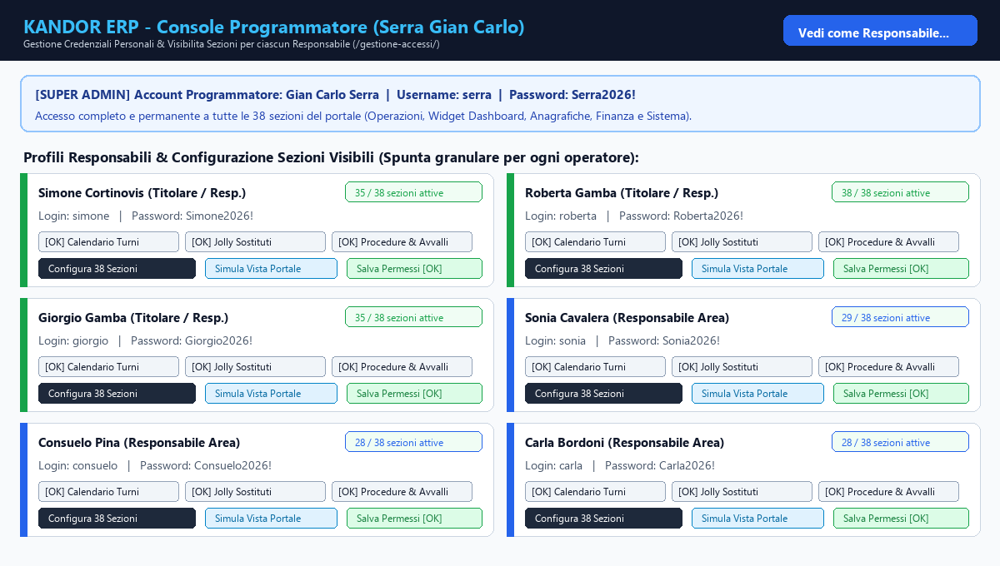
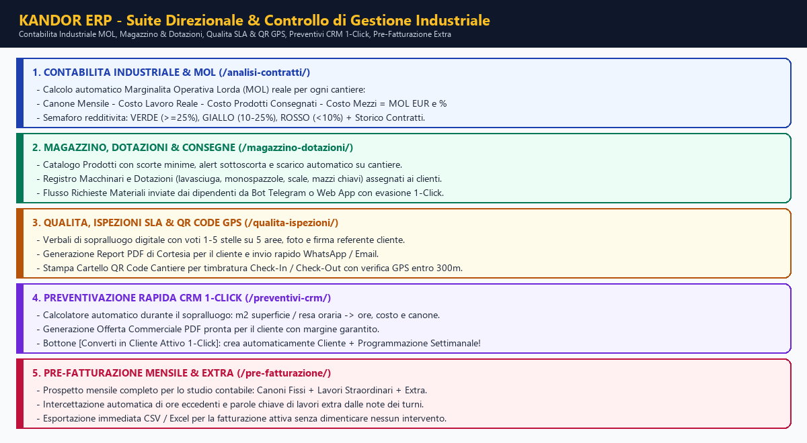

# KANDOR ERP - Enterprise Resource Planning
## Manuale d'Uso Completo, Introduzione Esaustiva alle Funzioni e Guida Operativa Passo-Passo

**Versione 3.3 — 13 Novembre 2026**  
*Sistema Gestionale ERP Integrato per Imprese di Pulizie, Multiservizi e Gestione Cantieri con Buste Paga Automatiche, Procedure con Avvallo, Controllo di Gestione MOL, Magazzino, Qualita SLA, CRM Preventivi, Pre-Fatturazione, Bot Telegram e Web App Mobile*

---

## INTRODUZIONE GENERALE E DESCRIZIONE ESAUSTIVA DELLE FUNZIONI DEL PROGRAMMA

### Cos'e KANDOR ERP e quale problema risolve
**KANDOR ERP - Enterprise Resource Planning** e la piattaforma gestionale cloud all-in-one progettata su misura per **Studio Serra / Kandor** per governare da un'unica centrale operativa l'intero ciclo di vita aziendale di un'impresa di pulizie e servizi integrati: dal sopralluogo commerciale e preventivazione, alla pianificazione automatica dei turni ricorrenti, fino alla timbratura e raccolta ore dal campo (via **Bot Telegram** e **Web App Mobile**), alla gestione delle sostituzioni per malattia/ferie, al controllo di gestione industriale (MOL per cantiere), alla logistica di magazzino e macchinari, alle ispezioni qualita SLA, all'elaborazione presenze per lo studio paghe e alla distribuzione automatica delle buste paga PDF ai lavoratori.

Il sistema elimina completamente fogli cartacei, file Excel scollegati, calcoli manuali a fine mese e comunicazioni disperse su chat personali, garantendo tracciabilita totale, precisione contabile al centesimo (`Decimal` con arrotondamento commerciale `ROUND_HALF_UP`) e disponibilita continua 24 ore su 24 su infrastruttura dedicata **VPS SerraStudio (`https://kandor.187.126.30.207.sslip.io`)**.

---

### Architettura Multi-Piattaforma: I 4 Ambienti Integrati di Kandor ERP

Kandor ERP opera attraverso quattro ambienti interconnessi in tempo reale sullo stesso database centrale PostgreSQL:

1. **Portale Direzionale e Amministrativo (`/admin/` e moduli dedicati)**  
   Destinato al **Programmatore (Gian Carlo Serra)**, ai **Titolari** (*Simone Cortinovis*, *Roberta Gamba*, *Giorgio Gamba*) e alle **Responsabili d'Area** (*Sonia Cavalera*, *Consuelo Pina*, *Carla Bordoni*). Ogni operatore accede con le proprie **credenziali personali** e visualizza esclusivamente le sezioni abilitate dal Programmatore tramite la Console Accessi (`/gestione-accessi/`).
2. **Web App Mobile Dipendenti (`/app/`) — Progressive Web App (PWA)**  
   Applicazione mobile installabile su qualsiasi smartphone Android e iPhone senza passare dagli store. Consente ai dipendenti di autenticarsi con **Codice Fiscale + PIN personale a 4 cifre** (o con un solo tocco tramite **Magic Link WhatsApp**), registrare le ore lavorate, effettuare il **Check-In / Check-Out GPS / QR Code** in cantiere, consultare il calendario turni e i compagni di squadra, inviare richieste di ferie/malattia/permessi/Legge 104, richiedere prodotti di magazzino che stanno finendo in cantiere, scaricare le proprie **Buste Paga PDF**, accettare sostituzioni e chattare con l'ufficio.
3. **Bot Telegram Ufficiale (`@kandor_gestionale_bot`)**  
   Assistente automatico interattivo attivo 24/7 su Telegram. I dipendenti si accreditano in autonomia inserendo **Codice Fiscale + PIN** (con blocco automatico anti-duplicato che impedisce a un secondo telefono di collegarsi allo stesso profilo) e utilizzano comodi pulsanti guidati (`Registra Ore`, `Calendario`, `Turni da compilare`, `Malattia`, `Ferie`, `Permesso`, `Richiedi Materiali Cantiere`, `Segnalazione`, `Buste Paga`, `Foto Profilo`, `Guida`) oppure scrivono frasi in linguaggio naturale comprensibili dal motore IA.
4. **Dashboard Esecutiva Titolari (`/titolari/`) e Centro IA (`/ia-hub/`)**  
   Cruscotto direzionale ad accesso riservato per l'analisi immediata dei KPI aziendali, della marginalita operativa lorda (MOL), dei costi del personale, dell'assenteismo e delle automazioni intelligenti a costo zero.

---

### Panoramica Completa dei Moduli e delle Funzioni del Programma

Di seguito sono descritte tutte le macro-funzioni che compongono l'ecosistema **KANDOR ERP**, ciascuna approfondita passo dopo passo nei capitoli successivi di questo manuale:

#### A. Governance Accessi, Sicurezza e Profilazione Ruoli
- **Account Programmatore Super-Admin (`serra` — Gian Carlo Serra)**: visione completa e incondizionata di tutte le **38 sezioni** del portale e accesso esclusivo alla **Console Gestione Accessi & Sezioni Responsabili (`/gestione-accessi/`)**.
- **Credenziali Personali per ciascun Responsabile**: eliminazione di qualsiasi menu a tendina condiviso per il cambio operatore; ogni Responsabile accede con il proprio username e password individuale e il sistema identifica automaticamente l'autore di ogni avvallo, messaggio o procedura.
- **Abilitazione Granulare delle 38 Sezioni + Modalita "Simula Vista"**: il Programmatore puo abilitare o nascondere con un clic singole Card, singoli Widget della Dashboard o singole Voci Anagrafiche per ciascun Responsabile, e testare in tempo reale l'interfaccia esatta vista da quel Responsabile.

#### B. Anagrafiche Centralizzate e Sicurezza Dati
- **Anagrafica Dipendenti**: gestione completa di dati fiscali, contatto telefonico, indirizzo (con geocodifica GPS automatica in background), contratto e ore settimanali, costo orario, PIN d'accesso a 4 cifre per Web App e Telegram, ID Telegram con **vincolo anti-duplicato**, foto profilo e due flag rapidi attivabili con 1 clic direttamente dalla lista (**`DISP. SOST.`** per la disponibilita alle sostituzioni e **`RIC.NOT.`** per ricevere le notifiche Telegram dei messaggi inviati dai dipendenti).
- **Anagrafica Clienti e Cantieri con Storicizzazione Contratti (`StoricoContrattoCliente`)**: gestione di ragione sociale, indirizzo cantiere geolocalizzato, referente, email/telefono, **Responsabile d'Area** assegnato, **Programmazione Ricorrente Settimanale** integrata nella stessa pagina e tracciamento automatico dello storico di ogni variazione di canone mensile, frequenza o stato contrattuale.
- **Anagrafica Squadre, Mezzi Aziendali, Qualifiche e Corsi di Formazione (D.Lgs. 81/08)**: composizione squadre con Caposquadra e componenti, parco automezzi con monitoraggio automatico di **Assicurazione, Revisione e Permesso ZTL Citta Alta**, catalogo qualifiche tecniche e scadenzario automatico di **Visite Mediche** e **Corsi di Sicurezza**.

#### C. Pianificazione Turni e Calendario Settimanale Interattivo
- **Generazione Automatica Turni da Programmazione Ricorrente**: creazione massiva dei turni futuri per 1, 2, 4, 8 o 12 settimane con salto automatico dei turni gia esistenti.
- **Calendario Settimanale Interattivo in Dashboard**: griglia visuale Lunedi-Domenica con barra di scorrimento superiore e inferiore sincronizzata, filtri per Stato, Responsabile d'Area e Squadra, e codifica cromatica immediata (**Grigio** = da svolgere, **Ambra** = ore parziali, **Verde** = completato e validato, **Rosso** = anomalia/scopertura).
- **Modale Operativa Turno All-in-One**: cliccando su qualsiasi card turno si apre la finestra che permette di inserire o correggere le ore di ciascun membro, leggere la **nota di motivazione** lasciata dal dipendente (se ha registrato ore diverse dal previsto), **deselezionare un assente scegliendo contestualmente il sostituto**, attivare una **sostituzione parziale solo su giorni specifici della settimana**, forzare sostituti occupati o senza Telegram, oppure **saltare un turno non effettuato**.

#### D. Raccolta Ore, Motivazione Scostamenti, Geofence GPS e Ricerca Jolly
- **Finestra Operativa di 31 Giorni**: i dipendenti possono compilare le ore del giorno corrente o recuperare i turni rimasti non compilati negli **ultimi 31 giorni**.
- **Richiesta Automatica della Motivazione per Ore Diverse dal Previsto**: se un lavoratore dichiara meno o piu ore rispetto all'orario contrattuale del turno (sia da Bot Telegram sia da Web App), il sistema chiede obbligatoriamente il motivo dello scostamento e lo espone con l'icona 💬 sul Calendario Settimanale e sul Calendario Mensile Paghe.
- **Timbratura Geofence GPS & QR Code Cantiere**: possibilita di stampare il cartello QR Code per ciascun cantiere (`/qualita-ispezioni/qr/<id>/`); il dipendente registra **Check-In** e **Check-Out** da smartphone con verifica automatica della distanza GPS (entro 300 metri dal cantiere) e calcolo automatico delle ore lavorate.
- **Motore Ricerca Sostituti (Jolly) con Smart Score IA (0-100)**: individuazione istantanea del miglior sostituto disponibile in base a vicinanza chilometrica (formula di Haversine), assenza di sovrapposizioni orarie, qualifica, mezzo e bilanciamento del monte ore settimanale, con invio richiesta su Telegram e Web App.

#### E. Procedure Operative con Avvallo Bloccante (`/procedure/`)
- **Gestione Pratiche e Checklist Multi-Step** (es. *Procedura di Disdetta Contratto Cliente*): creazione di modelli di procedura riutilizzabili con passaggi ordinati, assegnazione di una pratica a uno specifico cantiere, barra di avanzamento percentuale e **vincolo bloccante sui passaggi critici** che impedisce la spunta finche il collega incaricato non concede il proprio **OK / Avvallo** (tramite Dashboard o pulsante diretto su Telegram).
- **Visibilita Personale delle Procedure in Evidenza**: ogni Responsabile vede nel riquadro superiore della propria Dashboard esclusivamente le procedure che ha messo personalmente in evidenza e le richieste di avvallo indirizzate a lui.

#### F. Controllo di Gestione, Magazzino, Qualita SLA, Preventivi CRM e Pre-Fatturazione
- **Contabilita Industriale & Marginalita Cantiere (`/analisi-contratti/`)**: calcolo automatico del **MOL (Margine Operativo Lordo)** reale di ogni singolo cantiere incrociando *Canone Mensile − Costo Lavoro Reale − Costo Prodotti Consegnati − Costo Mezzi*, con semaforo di redditivita (**Verde >= 25%**, **Giallo 10-25%**, **Rosso < 10%**).
- **Magazzino Prodotti, Dotazioni Macchinari e Richieste Materiali (`/magazzino-dotazioni/`)**: inventario detergenti e consumabili con alert sottoscorta, registro delle dotazioni fisse assegnate a ciascun cantiere (lavasciuga, aspirapolvere, scale, mazzi chiavi con codice identificativo) e gestione 1-Click delle richieste di rifornimento inviate dai lavoratori dal campo.
- **Qualita, Ispezioni SLA & QR Code Cantiere (`/qualita-ispezioni/`)**: compilazione digitale dei verbali di sopralluogo con valutazione 1-5 stelle su 5 aree, foto prima/dopo, firma del referente e generazione del **Report PDF di Cortesia** da inviare al cliente su WhatsApp o Email.
- **Preventivazione Rapida CRM con Conversione 1-Click (`/preventivi-crm/`)**: calcolatore commerciale da sopralluogo (m² superficie ÷ resa oraria m²/h → ore consigliate, costo industriale e canone suggerito con margine garantito), stampa **Offerta Commerciale PDF** e bottone **`Converti in Cliente Attivo (1-Click)`** che crea automaticamente l'anagrafica Cliente e le relative Programmazioni Settimanali.
- **Pre-Fatturazione Mensile & Lavori Extra (`/pre-fatturazione/`)**: prospetto mensile completo per la fatturazione attiva che unisce Canoni Fissi, Lavori Straordinari a consuntivo e **Lavori Extra intercettati automaticamente dall'IA** nelle note dei turni, esportabile in CSV/Excel.

#### G. Elaborazione Presenze, Cedolini Paghe e Buste Paga PDF Automatiche
- **Report Ore (`/verifica-ore/`) e Cedolini Paghe (`/report-paghe/`)**: verifica e convalida delle ore mensili e generazione del prospetto completo per il Consulente del Lavoro con **Calendario Giornaliero Interattivo (giorni 1-31)** modificabile con un clic e riepilogo automatico di Ore Ordinarie, Straordinarie, Malattia, Ferie, Permessi e Legge 104.
- **Divisione Automatica Buste Paga PDF e Invio 1-Click (`/buste-paga/`)**: caricamento dell'**unico file PDF cumulativo** ricevuto dallo studio paghe; il sistema legge il **Codice Fiscale** in ogni pagina, **divide automaticamente il PDF in singoli cedolini**, li abbina a ciascun dipendente, li rende subito scaricabili nel **Bot Telegram (`📄 Buste Paga`)** e nella **Web App (`/app/`)** e permette l'invio massivo o singolo via **Telegram** e **WhatsApp** con tracciamento in tempo reale di consegna e lettura.

---

## INDICE DEI CAPITOLI DEL MANUALE AMMINISTRATORE ED ERP

1. **Accesso al Sistema, Ruoli e Navigazione Generale**
2. **Account Programmatore (`serra`) e Console Gestione Accessi & Sezioni Responsabili (`/gestione-accessi/`)**
3. **La Dashboard Principale: Intestazione, Card Rapide, Scadenze e Feed Live**
4. **Gestione Procedure Operative, Checklist e Avvalli tra Colleghi (`/procedure/`)**
5. **Anagrafica Dipendenti: Scheda Completa, Flag 1-Click (`DISP. SOST.`, `RIC.NOT.`), PIN e Sicurezza Telegram**
6. **Anagrafica Clienti, Cantieri, Programmazioni Integrate e Storico Contratti**
7. **Anagrafica Squadre, Mezzi Aziendali (ZTL), Qualifiche e Corsi di Formazione (D.Lgs. 81/08)**
8. **Programmazione Ricorrente e Generazione Automatica Massiva dei Turni**
9. **Il Calendario Settimanale Interattivo: Filtri, Colori, Scorrimento e Stampa**
10. **Gestione Operativa del Turno: Modifica Ore, Note Motivazione, Assenze, Sostituzioni Parziali e Salto Turno**
11. **Gestione Assenze (Malattia, Ferie, Permessi, Legge 104) e Flusso di Avvallo**
12. **Ricerca Sostituti (Jolly) e Sostituzioni Rapide con Smart Score IA**
13. **Time Tracking, Registrazione Ore (Finestra 31 Giorni) e Timbratura Geofence GPS / QR Code**
14. **Report Ore, Convalida Mensile e PDF Verifica Ore (`/verifica-ore/`)**
15. **Cedolini Paghe e Calendario Mensile Interattivo Giorni 1-31 (`/report-paghe/`)**
16. **Gestione Buste Paga: Split Automatico PDF per Codice Fiscale e Invio Telegram/WhatsApp (`/buste-paga/`)**
17. **Contabilita Industriale, Costi Reali e Marginalita MOL per Cantiere (`/analisi-contratti/`)**
18. **Magazzino Prodotti, Dotazioni Macchinari in Cantiere e Richieste Materiali (`/magazzino-dotazioni/`)**
19. **Qualita, Ispezioni SLA 1-5 Stelle, Report PDF Cliente e Cartelli QR Code (`/qualita-ispezioni/`)**
20. **Preventivazione Rapida CRM, Calcolo Resa m² e Conversione 1-Click in Cliente (`/preventivi-crm/`)**
21. **Pre-Fatturazione Mensile, Straordinari ed Extra Rilevati dall'IA (`/pre-fatturazione/`)**
22. **Centro Messaggi Chat & Telegram, Filtro Responsabili e Messaggi Programmati (`/chat-simulator/`)**
23. **Centro IA & Automazioni Smart a Costo Zero (`/ia-hub/`)**
24. **Gestione Dati (Import/Export Excel, Backup Sicuro) e Risoluzione Problemi Frequenti (FAQ)**

---

## 1. ACCESSO AL SISTEMA, RUOLI E NAVIGAZIONE GENERALE

### 1.1 Indirizzi Ufficiali del Portale (VPS Produzione 24/7)
Kandor ERP e pubblicato su connessione cifrata HTTPS e non richiede alcuna installazione sui computer dell'ufficio:

- **Ingresso Principale / Portale Amministrazione**: `https://kandor.187.126.30.207.sslip.io/admin/`
- **Console Programmatore (Configurazione Accessi & Sezioni)**: `https://kandor.187.126.30.207.sslip.io/gestione-accessi/`
- **Web App Mobile Dipendenti**: `https://kandor.187.126.30.207.sslip.io/app/`
- **Dashboard Esecutiva Titolari**: `https://kandor.187.126.30.207.sslip.io/titolari/`
- **Manuale Interattivo Web**: `https://kandor.187.126.30.207.sslip.io/manuale/`
- **Download Manuale Completo PDF**: `https://kandor.187.126.30.207.sslip.io/manuale/pdf/`
- **Download Guida Dipendente PDF**: `https://kandor.187.126.30.207.sslip.io/manuale-dipendente/pdf/`

### 1.2 Procedura Passo-Passo di Login al Portale Amministrativo
1. Aprire il browser (Google Chrome, Microsoft Edge, Firefox o Safari) e collegarsi a `https://kandor.187.126.30.207.sslip.io/admin/`.
2. Nella schermata di accesso intitolata su due righe:
   - Prima riga: **`KANDOR ERP -`**
   - Seconda riga: **`Enterprise Resource Planning`**
3. Inserire il proprio **Nome utente** personale e la propria **Password** personale.
4. Cliccare sul pulsante **Accedi**.
5. Il sistema riconosce automaticamente l'identita dell'operatore autenticato (mostrando un badge nominativo fisso in alto a destra nella barra della citazione del giorno, es. `👤 Operatore: Roberta Gamba`) e carica esclusivamente le sezioni abilitate per quel profilo.

> **Importante — Sicurezza Identita Operatore**: Dal portale e stata rimossa qualsiasi tendina di cambio rapido operatore. Ogni azione eseguita (creazione di una procedura, spunta di un passaggio, richiesta o concessione di un avvallo, invio di un messaggio chat) viene attribuita in modo certo e non falsificabile all'utente loggato con le proprie credenziali.

---

## 2. ACCOUNT PROGRAMMATORE (`serra`) E CONSOLE GESTIONE ACCESSI & SEZIONI RESPONSABILI (`/gestione-accessi/`)

### 2.1 L'Account Programmatore (Gian Carlo Serra)
Per garantire il controllo tecnico e organizzativo totale della piattaforma, e configurato l'account Super-Admin dedicato al Programmatore **Gian Carlo Serra**:
- **Username**: `serra`
- **Password predefinita**: `Serra2026!`
- **Privilegi**:
  - Visualizza **sempre il 100% delle 38 sezioni** del portale (Card Operazioni Frequenti, Moduli Direzionali ERP, Widget Dashboard, Calendario, Operativita Giornaliera, Anagrafiche e Amministrazione Sistema).
  - E l'unico profilo autorizzato ad aprire e modificare la **Console Configurazione Accessi & Sezioni Responsabili (`/gestione-accessi/`)**.
  - Dispone nella barra superiore del selettore rapido **`👁️ Vedi Dashboard come...`** per simulare con un clic la vista esatta di qualsiasi Responsabile.

### 2.2 Credenziali Personali dei Responsabili e Titolari
Il sistema mantiene sincronizzati gli account personali per ciascuno dei 6 Responsabili/Titolari aziendali:

| Nominativo Responsabile | Ruolo Aziendale | Username | Password Iniziale |
|---|---|---|---|
| **Gian Carlo Serra** | Programmatore (Super-Admin) | `serra` | `Serra2026!` |
| **Simone Cortinovis** | Titolare / Responsabile | `simone` | `Simone2026!` |
| **Roberta Gamba** | Titolare / Responsabile | `roberta` | `Roberta2026!` |
| **Giorgio Gamba** | Titolare / Responsabile | `giorgio` | `Giorgio2026!` |
| **Sonia Cavalera** | Responsabile d'Area | `sonia` | `Sonia2026!` |
| **Consuelo Pina** | Responsabile d'Area | `consuelo` | `Consuelo2026!` |
| **Carla Bordoni** | Responsabile d'Area | `carla` | `Carla2026!` |

### 2.3 Come Abilitare o Disabilitare le Sezioni per ciascun Responsabile (Passo-Passo)
1. Accedere al portale con l'account Programmatore (`serra` / `Serra2026!`).
2. Cliccare sul pulsante blu **`🛠️ Console Programmatore (Sezioni & Accessi)`** in alto a destra nella barra della Dashboard (oppure sulla card **`🛠️ Accessi & Sezioni`** nella griglia Operazioni Frequenti, o navigare direttamente su `/gestione-accessi/`).
3. Nella pagina **Console Programmatore** viene mostrata una scheda dedicata per ciascun Responsabile (*Simone Cortinovis*, *Roberta Gamba*, *Giorgio Gamba*, *Sonia Cavalera*, *Consuelo Pina*, *Carla Bordoni*).
4. All'interno della scheda del Responsabile desiderato, le **38 sezioni del portale** sono organizzate in **3 gruppi chiari**:
   - **Gruppo 1 — ⚡ Card Operazioni Frequenti & Moduli Principali (15 sezioni)**: *Jolly (Trova Sostituto)*, *Report Ore*, *Cedolini Paghe*, *Buste Paga*, *Chat & Telegram*, *App Dipendenti*, *Contabilita Industriale & MOL*, *Magazzino, Dotazioni & Consegne*, *Qualita, Ispezioni SLA & QR*, *Preventivazione Rapida CRM*, *Pre-Fatturazione & Lavori Extra*, *Procedure & Avvalli*, *Gestione Dati*, *Centro IA & Smart*, *Guide & Manuali*.
   - **Gruppo 2 — 📊 Widget, Scadenze & Calendario in Dashboard (8 sezioni)**: *Banner Procedure in Evidenza & Avvalli*, *Feed Operativo Live*, *Widget Scadenze Mezzi & ZTL*, *Widget Scadenze Visite Mediche*, *Widget Scadenze Corsi Formazione*, *Widget Compleanni*, *Widget Contratti Clienti in Scadenza*, *Calendario Programmazione Settimanale*.
   - **Gruppo 3 — 🗂️ Voci Operativita Giornaliera, Anagrafiche & Sistema (15 sezioni)**: *Assegnazioni Turni*, *Assenze*, *Time Tracking*, *Turni*, *Procedure Avviate*, *Lotti Buste Paga*, *Buste Paga Dipendenti*, *Dipendenti*, *Clienti & Programmazioni*, *Squadre*, *Mezzi Aziendali*, *Qualifiche*, *Corsi di Formazione*, *Modelli Procedura*, *Messaggi Programmati*, *Catalogo Prodotti & Scorte*, *Dotazioni & Macchinari Cantiere*, *Richieste & Consegne Materiali*, *Ispezioni Qualita & SLA*, *Preventivi & Sopralluoghi*, *Amministrazione Sistema & Utenti*.
5. **Spuntare** le caselle delle sezioni che il Responsabile deve vedere oppure **togliere la spunta** dalle sezioni che si desidera nascondergli.
   - E possibile usare i pulsanti rapidi di gruppo **`Abilita tutte`** / **`Solo operative standard`** / **`Deseleziona tutte`** per velocizzare la configurazione.
6. Se necessario, nella stessa scheda e possibile **modificare Username o reimpostare la Password** di quel Responsabile.
7. Cliccare sul pulsante verde **`💾 Salva Configurazione di [Nome Responsabile]`**.
8. **Effetto immediato**: non appena salvato, il Responsabile vedra nella propria Dashboard solo ed esclusivamente le sezioni spuntate, e qualsiasi tentativo di aprire manualmente tramite URL una sezione disabilitata verra bloccato automaticamente dal sistema con un messaggio di accesso riservato.

### 2.4 Come Usare la Modalita "Simula Vista Responsabile" (`👁️ Vedi come...`)
1. Dalla Console `/gestione-accessi/` (oppure dal menu a tendina **`👁️ Vedi Dashboard come...`** presente in alto in Dashboard per l'utente `serra`), selezionare il nome di un Responsabile (es. *Sonia Cavalera*) e cliccare su **`👁️ Simula Vista`**.
2. Il sistema apre la Dashboard mostrando un banner giallo in alto: **`👁️ MODALITA ANTEPRIMA ATTIVA: Stai visualizzando il portale esattamente come lo vede Sonia Cavalera`**.
3. Dopo aver verificato che le sezioni visibili siano quelle desiderate, cliccare sul pulsante **`❌ Esci dall'Anteprima (Torna a Vista Programmatore)`** per ripristinare la vista completa.

---

## 3. LA DASHBOARD PRINCIPALE: INTESTAZIONE, CARD RAPIDE, SCADENZE E FEED LIVE

Appena effettuato il login su `/admin/`, si apre la **Dashboard Operativa Centrale**, strutturata dall'alto verso il basso nei seguenti blocchi funzionali:

### 3.1 Intestazione su Due Righe e Barra Citazione del Giorno
- **Intestazione Principale**: in alto a sinistra compare il titolo ufficiale distribuito su due righe per la massima leggibilita su ogni schermo:
  - **`KANDOR ERP -`**
  - **`Enterprise Resource Planning`**
- **Barra del Giorno e Identita Operatore**: subito sotto l'intestazione mostra una frase motivazionale giornaliera, il badge fisso con il nome del Responsabile loggato (`👤 Operatore: ...`) e, per il Programmatore, i comandi rapidi per la Console Accessi (`/gestione-accessi/`).

### 3.2 Riquadro Superiore "Procedure in Evidenza & Richieste di Avvallo"
Se l'operatore loggato ha messo in evidenza una o piu pratiche operative (es. una disdetta cantiere in corso) oppure se un collega gli ha richiesto un **OK / Avvallo** su un passaggio, in cima alla Dashboard compare il pannello dedicato che consente di:
- Vedere la percentuale di avanzamento di ciascuna procedura personale in evidenza;
- Spuntare direttamente i passaggi completati;
- Cliccare su **`✅ Concedi OK / Avvallo`** sui passaggi richiesti dai colleghi.

### 3.3 Griglia "Operazioni Frequenti" (Accesso Rapido con 1 Clic)
Raccoglie le card colorate per aprire istantaneamente i moduli operativi e direzionali (in base ai permessi abilitati per l'utente):
- **🏥 Jolly (`Trova Sostituto`)** → `/find-jolly/`
- **📊 Report Ore (`Verifica Ore`)** → `/verifica-ore/`
- **📋 Cedolini Paghe (`Elabora Paghe`)** → `/report-paghe/`
- **📄 Buste Paga (`Split PDF & Invio` con badge contatore)** → `/buste-paga/`
- **💬 Chat & Telegram (`Centro Messaggi`)** → `/chat-simulator/`
- **📲 App Dipendenti (`Apri Web App`)** → `/app/`
- **💰 Contabilita & MOL (`Analisi Contratti`)** → `/analisi-contratti/`
- **📦 Magazzino & Dotazioni (`Prodotti, Macchinari & Consegne`)** → `/magazzino-dotazioni/`
- **⭐ Qualita, SLA & QR (`Verbali Ispezione & QR GPS`)** → `/qualita-ispezioni/`
- **📐 Preventivi CRM (`Calcolo m² & Conversione 1-Click`)** → `/preventivi-crm/`
- **🧾 Pre-Fatturazione (`Canoni, Straordinari & Extra IA`)** → `/pre-fatturazione/`
- **📋 Procedure (`Checklist & Avvalli` con badge contatore)** → `/procedure/`
- **💾 Gestione Dati (`Import/Export/Backup`)** → `/data-management/`
- **🤖 Centro IA & Smart (`5 Moduli Zero-Cost`)** → `/ia-hub/`
- **📘 Guide & Manuali (`Manuale Web, PDF & Podcast`)** → `/manuale/`

### 3.4 I 6 Pannelli di Monitoraggio Automatico Scadenze e Feed Live
Subito sotto le card rapide sono disposti i widget di controllo preventivo:
1. **📱 Feed Operativo Live (Telegram & Web App)**: mostra in tempo reale le ultime ore registrate dai dipendenti, le assenze comunicate e le segnalazioni inviate dai cantieri, con indicatore del canale usato (`[TG]` o `[APP]`).
2. **🚗 Scadenze Mezzi & Permessi ZTL**: avvisa con semaforo **Rosso** (scaduto) o **Giallo** (in scadenza entro 30 giorni) per Assicurazione, Revisione e Permesso ZTL Citta Alta di ogni furgone/auto aziendale.
3. **🩺 Scadenze Visite Mediche**: elenca i lavoratori con visita medica di idoneita scaduta o in scadenza entro 30 giorni.
4. **🎓 Scadenze Corsi di Formazione (D.Lgs. 81/08)**: segnala gli attestati obbligatori (Sicurezza Generale, Specifica, Primo Soccorso, Antincendio, Preposti, ecc.) scaduti o in scadenza entro 60 giorni.
5. **🎂 Compleanni in Arrivo**: ricorda i compleanni dei dipendenti e dei referenti dei clienti nei prossimi 30 giorni.
6. **📄 Contratti Clienti in Scadenza**: mostra le programmazioni contrattuali in scadenza entro 30 giorni con il bottone rapido **`Proroga 1 Anno`** per rinnovare il contratto con un solo clic.

### 3.5 Calendario Settimanale e Colonne Tabelle in Fondo alla Dashboard
- Al centro della pagina si sviluppa il **Calendario Programmazione Settimanale** interattivo (descritto nel Capitolo 9).
- In fondo alla Dashboard si trovano le **3 colonne strutturali** (*Operativita Giornaliera*, *Anagrafiche*, *Amministrazione Sistema*) per accedere direttamente agli archivi tabellari completi.

---

## 4. GESTIONE PROCEDURE OPERATIVE, CHECKLIST E AVVALLI TRA COLLEGHI (`/procedure/`)

Il modulo **Procedure & Avvalli (`/procedure/`)** permette di standardizzare qualsiasi processo aziendale delicato (a partire dalla **Procedura di Disdetta Contratto Cliente**, preinstallata di default) trasformandolo in una checklist digitale tracciata passo dopo passo, con richiesta di conferma (Avvallo) ai colleghi responsabili.

### 4.1 Come Avviare una Nuova Pratica / Procedura per un Cliente (Passo-Passo)
1. Dalla Dashboard cliccare sulla card **📋 Procedure** (oppure aprire `https://kandor.187.126.30.207.sslip.io/procedure/`).
2. Nel riquadro superiore **"Avvia Nuova Pratica / Procedura"**:
   - **Modello di Procedura**: selezionare il modello desiderato (es. *Procedura di Disdetta Contratto Cliente*).
   - **Titolo Pratica**: inserire un nome chiaro (es. *Disdetta Condominio Rossi - Chiusura 30/11*).
   - **Cliente / Cantiere associato**: selezionare il cliente dall'elenco (opzionale ma consigliato).
   - **Data Scadenza Pratica**: indicare entro quando la pratica deve essere completata.
   - **Note Generali**: inserire eventuali dettagli (es. *Ritiro chiavi e lavasciuga entro fine mese*).
   - **Metti in evidenza nella mia Dashboard**: lasciare attiva la spunta se si desidera vedere questa pratica fissa in cima alla propria Dashboard.
3. Cliccare sul pulsante **`🚀 Avvia Pratica`**.
4. Il sistema genera istantaneamente la scheda della pratica con tutti i passaggi previsti dal modello e la assegna al Responsabile attualmente loggato.

### 4.2 Come Lavorare i Passaggi della Checklist e Richiedere l'Avvallo (OK) a un Collega
Ogni passaggio all'interno di una pratica avviata offre i seguenti controlli:
1. **Richiesta di Avvallo a un Collega**:
   - Se un passaggio richiede la verifica o il consenso di un altro Responsabile (es. *Roberta Gamba* per la verifica contabile di fine contratto o *Simone Cortinovis* per il ritiro macchinari), selezionare il nome del collega nel menu **`Richiedi OK a...`** a fianco del passaggio e cliccare su **`Richiedi OK`**.
   - Il sistema invia una **notifica immediata su Telegram** al collega selezionato (con il pulsante interattivo **`✅ Da l'OK su Telegram`**) e fa comparire la richiesta in cima alla sua Dashboard.
2. **Vincolo Bloccante di Sicurezza sui Passaggi con Avvallo**:
   - **Regola fondamentale**: quando un passaggio prevede l'avvallo di un collega (perche previsto dal modello o perche richiesto), **la casella di spunta del passaggio rimane bloccata (`🔒 In attesa di OK`)** e non puo essere segnata come completata finche il collega incaricato non ha dato il proprio OK!
   - Non appena il collega clicca su **`✅ Concedi OK`** (dalla propria Dashboard o direttamente dal messaggio ricevuto sul Bot Telegram), il passaggio mostra il badge verde **`✅ Avvallato da [Nome Collega] il [Data/Ora]`** e la casella diventa spuntabile.
3. **Spunta di Completamento, Modifica ed Eliminazione Passaggi**:
   - Cliccare sulla casella **`[ ]`** a sinistra del passaggio per segnarlo come **Completato** (il sistema registra chi lo ha completato e l'ora esatta, aggiornando la barra percentuale `0% -> 100%`).
   - E possibile **aggiungere un passaggio extra** specifico per quella pratica cliccando su **`+ Aggiungi Passaggio a questa Pratica`**, **modificare il testo** di un passaggio o **eliminare** una voce non applicabile a quel singolo cantiere.

### 4.3 Visibilita Personale in Dashboard ("Metti in Evidenza")
- Il pulsante **`📌 In Evidenza`** presente su ogni pratica e **personale per il Responsabile che ha creato o segue la pratica**: se *Sonia Cavalera* mette in evidenza una propria pratica, questa comparira in cima alla Dashboard di *Sonia Cavalera* senza intasare la Dashboard degli altri Responsabili (a meno che non sia richiesto un loro avvallo su uno specifico passaggio).

### 4.4 Creazione e Personalizzazione dei Modelli di Procedura Riutilizzabili
Nella colonna destra della pagina `/procedure/` (sezione **Catalogo Modelli Base**) e possibile:
1. Creare un nuovo modello riutilizzabile (es. *Apertura Nuovo Cantiere*, *Assunzione Nuovo Dipendente*, *Manutenzione Straordinaria Macchinario*);
2. Aggiungere, riordinare o modificare le voci standard del modello e indicare quali voci richiedono obbligatoriamente un avvallo collegiale.

---

## 5. ANAGRAFICA DIPENDENTI: SCHEDA COMPLETA, FLAG 1-CLICK (`DISP. SOST.`, `RIC.NOT.`), PIN E SICUREZZA TELEGRAM

### 5.1 Come Accedere all'Elenco Dipendenti
1. Dalla Dashboard scorrere fino alla colonna **Anagrafiche** e cliccare su **Dipendenti** (oppure aprire `/admin/core/dipendente/`).
2. La tabella mostra per ogni lavoratore: **Cognome e Nome**, **Codice Fiscale**, **PIN App**, **Stato**, **Telefono**, **Collegamento Telegram**, e le due colonne interattive con spunta rapida **`DISP. SOST.`** e **`RIC.NOT.`**.

### 5.2 I Due Flag Rapidi Modificabili con 1 Clic nella Lista Dipendenti
Direttamente nella tabella elenco dei Dipendenti (senza dover entrare nella singola scheda) sono presenti due caselle di spunta immediate:
1. **`DISP. SOST.` (Disponibile per Sostituzioni)**:
   - Se **spuntato**, il lavoratore viene incluso dal motore di ricerca **Jolly (`/find-jolly/`)** e dallo **Smart Score IA** tra i candidati proponibili quando bisogna coprire un assente.
   - Se **deselezionato**, il lavoratore non verra proposto come sostituto.
2. **`RIC.NOT.` (Riceve Notifiche Messaggi — Solo Responsabili)**:
   - Determina quali Responsabili/Titolari ricevono sul proprio smartphone (via Telegram) le notifiche in tempo reale quando i dipendenti scrivono messaggi in chat, segnalano anomalie o richiedono materiali.
   - Dopo aver modificato una o piu spunte `DISP. SOST.` o `RIC.NOT.`, cliccare sul pulsante **`Salva`** in fondo o in cima alla tabella.

### 5.3 Come Creare o Modificare un Dipendente Passo-Passo
1. Cliccare su **`+ Aggiungi Dipendente`** in alto a destra (o cliccare sul nome di un dipendente esistente).
2. Compilare le sezioni della scheda:
   - **Dati Anagrafici**: *Nome*, *Cognome*, *Codice Fiscale* (16 caratteri; viene normalizzato automaticamente in maiuscolo), *Data di nascita*, *Telefono cellulare*, *Email*, *Stato* (`ATTIVO`, `SOSPESO`, `CESSATO`) e *Foto profilo*.
   - **Indirizzo e Geolocalizzazione**: inserire *Indirizzo di residenza/domicilio* e *Citta*. Al salvataggio il sistema calcola automaticamente in background le coordinate GPS (*Latitudine* e *Longitudine*) necessarie per calcolare la distanza esatta dai cantieri.
   - **Dati Contrattuali e Sicurezza**:
     - *Ore settimanali da contratto* (es. `40.00` o `20.00`): usate per verificare chi ha ancora margine orario disponibile.
     - *Costo orario aziendale (€/h)*: utilizzato dal modulo **Contabilita Industriale (`/analisi-contratti/`)** per calcolare il costo reale del lavoro su ogni cantiere.
     - *Data ultima Visita Medica* e *Data scadenza Visita Medica*: alimentano il widget scadenze in Dashboard.
     - *Usufruisce Legge 104*: se spuntato, abilita per quel lavoratore il pulsante dedicato **`Legge 104`** sia nel Bot Telegram sia nella Web App Mobile.
     - *E Caposquadra*: indica che il lavoratore puo guidare una squadra e compilare verbali ispettivi da mobile.
   - **Credenziali Web App Mobile & Accreditamento Sicuro Telegram**:
     - **PIN Accesso App (4 cifre)**: se lasciato vuoto, il sistema genera automaticamente un PIN univoco a 4 cifre (es. `4829`).
     - **Telegram Chat ID**: viene compilato automaticamente quando il dipendente esegue l'accreditamento sul Bot `@kandor_gestionale_bot`.
   - **Qualifiche e Corsi di Formazione (in fondo alla scheda)**:
     - Selezionare le qualifiche tecniche possedute (es. *Vetri in quota*, *Uso Monospazzola/Lavasciuga*) e compilare le date di esecuzione/scadenza dei corsi obbligatori D.Lgs. 81/08.
3. Cliccare su **`Salva`** in fondo alla pagina.

### 5.4 Sicurezza Anti-Duplicato Telegram (Blocco Secondo Telefono)
Per impedire errori di abbinamento o accessi non autorizzati da dispositivi di terzi:
- **Unicita assoluta del Telegram Chat ID**: in anagrafica e nell'importazione Excel il sistema impedisce di assegnare lo stesso `telegram_chat_id` a due dipendenti diversi.
- **Protezione sul Bot Telegram (`@kandor_gestionale_bot`)**: una volta che un dipendente ha collegato il proprio smartphone al Bot tramite Codice Fiscale + PIN, se una seconda persona o un secondo telefono tenta di accreditarsi inserendo il Codice Fiscale di quel dipendente, **il sistema blocca automaticamente il secondo telefono** senza scollegare il telefono originale e senza inviare messaggi allarmanti al lavoratore.
- **Come cambiare telefono a un dipendente**: se un lavoratore cambia realmente smartphone o account Telegram, l'amministratore non deve far altro che aprire la scheda del dipendente in `/admin/core/dipendente/`, **svuotare il campo `Telegram Chat ID`**, cliccare su **Salva** e far scrivere `/start` al dipendente dal nuovo telefono.

---

## 6. ANAGRAFICA CLIENTI, CANTIERI, PROGRAMMAZIONI INTEGRATE E STORICO CONTRATTI

### 6.1 Come Censire un Cliente / Cantiere e Impostare la Programmazione nella Stessa Pagina
1. Dalla Dashboard andare su **Anagrafiche → Clienti** (`/admin/core/cliente/`) e cliccare su **`+ Aggiungi Cliente`**.
2. Compilare i dati del cantiere:
   - **Ragione Sociale / Nome Condominio o Azienda** e **Partita IVA / Codice Fiscale**.
   - **Indirizzo completo del cantiere** (Via, Civico, CAP, Citta): indispensabile per la geocodifica automatica GPS, per il controllo distanza del QR Code e per il calcolo vicinanza sostituti.
   - **Referente Cliente, Telefono Referente ed Email** (usati per l'invio rapido dei verbali di qualita e delle comunicazioni).
   - **Responsabile d'Area Kandor**: selezionare la Responsabile che governa il cantiere (es. *Sonia Cavalera*, *Consuelo Pina*, *Carla Bordoni*).
   - **Dati Economici e Contrattuali**:
     - *Tipo Contratto* (`CANONE FISSO MENSILE`, `A CONSUNTIVO ORARIO`, `UNA TANTUM / STRAORDINARIO`);
     - *Importo Canone Mensile (€)* o *Tariffa Oraria di Fatturazione (€/h)*;
     - *Data Inizio Contratto* e *Data Scadenza Contratto* (monitorata dal widget Contratti in Scadenza).
3. **Sezione Integrata "Programmazione Settimanale Ricorrente" (in fondo alla scheda Cliente)**:
   - Senza cambiare pagina, definire i giorni e gli orari in cui il cantiere deve essere pulito:
     - Selezionare la **Squadra** assegnata;
     - Spuntare i **Giorni della settimana** (es. *Lunedi* e *Giovedi*);
     - Inserire **Orario Inizio** (es. `06:00`), **Orario Fine** (es. `09:00`) e **Ore Previste Contratto** (es. `3.00`);
     - Indicare la **Frequenza** (`Settimanale`, `Quindicinale`, `Mensile`) e il **Periodo di validita**.
   - Se il cliente ha piu turni o piu squadre in giorni diversi, cliccare su **`+ Aggiungi un'altra Programmazione Settimanale`**.
4. Cliccare su **`Salva`**.

### 6.2 Storicizzazione Automatica delle Modifiche Contrattuali (`StoricoContrattoCliente`)
Ogni volta che nella scheda di un Cliente viene modificato il **Canone Mensile**, il **Tipo Contratto**, le **Ore Previste** o lo **Stato Attivo**, il sistema registra automaticamente una riga immutabile nella tabella **Storico Contratti Cliente** (visibile direttamente dentro la scheda del Cliente), conservando:
- Data e ora della variazione;
- Valore precedente e nuovo valore del canone;
- Utente che ha effettuato la modifica e note contrattuali.
In questo modo il calcolo del **MOL (`/analisi-contratti/`)** e la **Pre-Fatturazione (`/pre-fatturazione/`)** mantengono sempre la tracciabilita storica dei listini applicati.

---

## 7. ANAGRAFICA SQUADRE, MEZZI AZIENDALI (ZTL), QUALIFICHE E CORSI DI FORMAZIONE (D.LGS. 81/08)

### 7.1 Creazione e Modifica delle Squadre Operative (`/admin/core/squadra/`)
1. Aprire **Anagrafiche → Squadre** e cliccare su **`+ Aggiungi Squadra`**.
2. Inserire il **Nome della Squadra** (es. *Squadra 01 - Bergamo Centro*).
3. Selezionare il **Caposquadra** e spostare nel riquadro di destra i **Componenti** attivi della squadra.
4. Associare l'eventuale **Mezzo Aziendale predefinito** utilizzato dalla squadra e cliccare su **`Salva`**.

### 7.2 Gestione Parco Mezzi Aziendali e Permessi ZTL Citta Alta (`/admin/core/mezzo/`)
1. Aprire **Anagrafiche → Mezzi Aziendali** e cliccare su **`+ Aggiungi Mezzo`**.
2. Inserire **Targa**, **Modello/Descrizione**, **Costo Giornaliero/Mensile stimato** e le **3 date di scadenza monitorate**:
   - *Scadenza Assicurazione RCA*;
   - *Scadenza Revisione Ministeriale*;
   - *Scadenza Permesso ZTL / Citta Alta* (spuntando la casella `Abilitato ZTL Citta Alta` se il mezzo possiede il pass).
3. Il modulo **Compliance IA (`/ia-hub/`)** e il widget Dashboard segnaleranno automaticamente se una squadra viene inviata in un cantiere in zona ZTL con un mezzo privo di permesso valido.

### 7.3 Qualifiche Tecniche e Corsi di Sicurezza D.Lgs. 81/08
- **Qualifiche (`/admin/core/qualifica/`)**: consente di definire competenze speciali (es. *Piattaforme Aeree PLE*, *Pulizia Vetri in Quota*, *Trattamento Cotto/Marmo*). Quando una qualifica e richiesta da un cantiere, il motore **Jolly** privilegia i lavoratori che la possiedono.
- **Corsi di Formazione (`/admin/core/corsoformazione/`)**: gestisce il catalogo dei corsi obbligatori con la relativa durata di validita in mesi/anni. All'interno di ogni scheda Dipendente sono presenti le righe di tutti i corsi standard: basta inserire la **Data di Esecuzione** e il sistema calcola da solo la **Data di Scadenza**, alimentando gli avvisi in Dashboard.

---

## 8. PROGRAMMAZIONE RICORRENTE E GENERAZIONE AUTOMATICA MASSIVA DEI TURNI

### 8.1 Come Generare Automaticamente i Turni sul Calendario (Passo-Passo)
Una volta impostate le **Programmazioni Settimanali** dentro le schede dei Clienti (Capitolo 6), non serve creare i singoli turni giorno per giorno:
1. Andare in **Anagrafiche → Clienti** (oppure aprire direttamente **Programmazioni Settimanali**).
2. Selezionare con la casella di spunta a sinistra i clienti o le programmazioni desiderate (oppure cliccare su **Seleziona tutti** in alto a sinistra).
3. Nel menu a tendina **Azione** in alto, scegliere una delle opzioni di generazione automatica:
   - **`Genera turni per la prossima settimana (1 settimana)`**
   - **`Genera turni per le prossime 2 settimane`**
   - **`Genera turni per le prossime 4 settimane (1 mese)`**
   - **`Genera turni per le prossime 8 settimane (2 mesi)`**
   - **`Genera turni per le prossime 12 settimane (3 mesi)`**
4. Cliccare sul pulsante **`Vai`**.
5. **Protezione Anti-Duplicato**: il sistema genera tutte le giornate, le squadre e gli orari previsti per il periodo scelto e **salta automaticamente i turni gia esistenti**, evitando qualsiasi duplicazione.

---

## 9. IL CALENDARIO SETTIMANALE INTERATTIVO: FILTRI, COLORI, SCORRIMENTO E STAMPA

Il **Calendario Programmazione Settimanale** posto al centro della Dashboard e il cuore operativo giornaliero del portale.

### 9.1 Navigazione, Barra di Scorrimento Sincronizzata e Filtri Rapidi
- **Frecce di Navigazione Settimana**: usare i pulsanti **`◀ Settimana Precedente`**, **`Oggi (Settimana Corrente)`** e **`Settimana Successiva ▶`** per spostarsi nel tempo, oppure scegliere una data specifica dal selettore calendario.
- **Doppia Barra di Scorrimento Orizzontale Sincronizzata**: per agevolare la consultazione quando ci sono molte squadre, una barra di scorrimento orizzontale e posizionata **anche in alto sopra le intestazioni dei giorni** (Lunedi-Domenica), sincronizzata in tempo reale con la griglia sottostante.
- **Filtri Combinabili in Tempo Reale**:
  1. **Filtro Stato Turno**: *Tutti*, *Completati (Verdi)*, *Parziali (Ambra)*, *Da Svolgere (Grigi)*, *Anomalie / Scoperti (Rossi)*.
  2. **Filtro Responsabile d'Area**: permette a ciascuna Responsabile (*Sonia*, *Consuelo*, *Carla*, *Roberta*, *Simone*, *Giorgio*) di isolare con un clic solo i propri cantieri.
  3. **Filtro Squadra / Ricerca Testuale**: filtra istantaneamente per nome squadra, nome cantiere o cognome di un lavoratore.
- **Pulsante `🖨️ Stampa Prospetto Settimanale`**: genera una vista pulita ottimizzata per la stampa su carta o l'esportazione in PDF del calendario filtrato.

### 9.2 Significato dei Colori e delle Icone sulle Card Turno
Ogni rettangolo (Card Turno) nella griglia settimanale mostra:
- **Orario previsto** (es. `06:00 - 09:00`) e **Nome del Cliente/Cantiere**;
- **Elenco dei lavoratori** assegnati con il rispettivo stato individuale (`✓ 3h`, `⏳`, `🔄 Sostituto`, `✗ Escluso`);
- **Icona `💬` (Nota / Motivazione Dipendente)**: compare automaticamente quando un dipendente ha inserito una motivazione per aver lavorato un numero di ore diverso da quello previsto (passando il mouse sull'icona o aprendo il turno si legge il testo completo della motivazione);
- **Colore del Bordo e dello Sfondo**:
  - ⚪ **Grigio**: turno futuro o odierno non ancora compilato;
  - 🟡 **Ambra / Giallo**: turno compilato solo da una parte della squadra o in attesa di validazione;
  - 🟢 **Verde**: turno completato con tutte le ore registrate e validate;
  - 🔴 **Rosso**: turno con anomalia, assenza non ancora coperta o turno saltato.

---

## 10. GESTIONE OPERATIVA DEL TURNO: MODIFICA ORE, NOTE MOTIVAZIONE, ASSENZE, SOSTITUZIONI PARZIALI E SALTO TURNO

Cliccando su qualsiasi **Card Turno** all'interno del Calendario Settimanale si apre la **Finestra Modale Operativa del Turno**, dalla quale l'amministratore puo eseguire qualsiasi intervento senza mai uscire dalla Dashboard.

### 10.1 Inserimento o Modifica Manuale delle Ore e Lettura Motivazione Dipendente
1. Nella lista dei componenti della squadra mostrata nella modale, accanto a ogni lavoratore e presente la casella **Ore Lavorate** (precompilata con le ore dichiarate dal dipendente o con le ore previste da contratto).
2. Se il dipendente ha dichiarato un orario diverso dal previsto (es. `4.0h` invece di `3.0h`), sotto il suo nome compare in evidenza il riquadro giallo con la **Motivazione scritta dal dipendente** (es. *"💬 Nota dipendente: Richiesta pulizia straordinaria vetri ingresso da amministratore"*).
3. L'operatore d'ufficio puo confermare o rettificare il numero di ore e cliccare su **`💾 Salva e Valida Turno`**: tutti i lavoratori spuntati vengono salvati e validati contemporaneamente.

### 10.2 Deselezione di un Assente e Scelta Contestuale del Sostituto (Singolo Giorno o Giorni Specifici)
Quando un lavoratore della squadra e assente per quel turno:
1. **Togliere la spunta (`[ ]`)** accanto al nome del lavoratore assente nella modale del turno.
2. **Comparsa automatica del pannello Sostituzione Contestuale**: non appena si toglie la spunta, sotto il lavoratore si apre automaticamente il selettore **`🔄 Sostituisci con...`**.
3. **Scelta del Sostituto**:
   - Il menu a tendina mostra in cima i **Jolly disponibili e liberi** ordinati per vicinanza e compatibilita;
   - Più in basso mostra anche i lavoratori **impegnati in altri turni** o **senza Telegram** (chiaramente etichettati): selezionandoli, compare la spunta **`⚠️ Forza assegnazione anche se occupato / senza Telegram`** per consentire all'ufficio di gestire qualsiasi emergenza reale.
4. **Scelta dei Giorni di Sostituzione (Sostituzione Parziale o Multi-Giorno)**:
   - Di default e selezionato **solo il giorno del turno cliccato**;
   - Se invece il lavoratore va sostituito su quel cantiere per **piu giorni specifici della settimana** (es. *solo Martedi e Giovedi*, lasciando il titolare il Sabato), basta spuntare le caselle dei giorni desiderati (`Lun`, `Mar`, `Mer`, `Gio`, `Ven`, `Sab`, `Dom`) mostrate direttamente nel riquadro!
5. Cliccare su **`💾 Salva Modifiche Turno`**: il lavoratore assente viene escluso solo nei giorni selezionati e il sostituto viene inserito con notifica automatica.

### 10.3 Come Registrare un "Turno Saltato / Non Effettuato"
Se un intero intervento non e stato eseguito (es. cantiere chiuso per festivita locale o richiesta del cliente):
1. Aprire la modale del turno sul Calendario;
2. Cliccare sul pulsante **`⏭️ Segna Turno come Saltato / Non Effettuato`** e indicarne brevemente il motivo;
3. Il turno viene contrassegnato e nessuna ora viene addebitata ne ai dipendenti ne al cliente.

---

## 11. GESTIONE ASSENZE (MALATTIA, FERIE, PERMESSI, LEGGE 104) E FLUSSO DI AVVALLO

### 11.1 Come Arrivano le Assenze nel Sistema
Le assenze dei lavoratori possono entrare in Kandor ERP attraverso tre canali sincronizzati:
1. **Dal Bot Telegram (`@kandor_gestionale_bot`)**: il lavoratore preme `Malattia`, `Ferie`, `Permesso` o `Legge 104`, seleziona le date (ed eventuale fascia oraria o codice PUC INPS) e invia la richiesta.
2. **Dalla Web App Mobile (`/app/`)**: il lavoratore apre il tab **Assenze** e compila il modulo guidato.
3. **Inserimento Manuale da Ufficio (`/admin/core/assenza/add/`)**: un Responsabile inserisce direttamente l'assenza comunicata telefonicamente.

### 11.2 Tipologie di Assenza e Regole Specifiche
- **MALATTIA**: richiede **Data Inizio**, **Data Fine** e **Numero Protocollo Certificato Medico INPS (PUC)** (inseribile subito o integrabile entro 48 ore).
- **FERIE**: richiede **Data Inizio** e **Data Fine** (giornate intere).
- **PERMESSO (ROL / Personale)**: può essere per **Giornata Intera** oppure **Orario** (specificando *Ora Inizio*, *Ora Fine* e *Ore di Permesso*).
- **LEGGE 104**: visibile solo ai lavoratori che hanno il flag `Usufruisce Legge 104` attivo nella scheda Dipendente; supporta sia giornata intera sia permesso orario.

### 11.3 Procedura Passo-Passo di Verifica, Avvallo (`Avvallata da`) e Copertura Turni Scoperti
1. Dalla Dashboard andare in **Operativita Giornaliera → Assenze** (`/admin/core/assenza/`).
2. Ogni richiesta inviata da un dipendente nasce con stato *In attesa di verifica*:
   - Cliccare sulla riga dell'assenza per aprirla;
   - Verificare le date, le note ed eventuale certificato medico;
   - Spuntare la casella **`Avvallata / Approvata`** e confermare il Responsabile nel campo **`Avvallata da`**;
   - Cliccare su **`Salva`**.
3. **Esclusione Automatica dai Turni e Ricerca Sostituto**:
   - Quando un'assenza viene registrata/avvallata, il sistema **esclude automaticamente il lavoratore assente** da tutte le assegnazioni turno comprese tra la data di inizio e la data di fine (o nella fascia oraria del permesso), lasciando intatti i compagni di squadra;
   - Direttamente dalla pagina Assenze o dalla card **🏥 Jolly (`/find-jolly/`)** l'operatore puo coprire i turni rimasti scoperti con un clic.

---

## 12. RICERCA SOSTITUTI (JOLLY) E SOSTITUZIONI RAPIDE CON SMART SCORE IA

### 12.1 Come Funziona il Modulo "Jolly (Trova Sostituto)" (`/find-jolly/`)
Quando un lavoratore si ammala o va in ferie, il modulo **🏥 Jolly** individua in pochi secondi chi puo sostituirlo:
1. Dalla Dashboard cliccare sulla card **🏥 Jolly (`Trova Sostituto`)** (oppure aprire `/find-jolly/`).
2. Nella parte superiore vengono elencati automaticamente tutti i **Turni Scoperti / Con Assenze** dei prossimi giorni (oppure e possibile cercare manualmente per **Data**, **Fascia Oraria** e **Cantiere/Cliente**).
3. Cliccando su **`🔍 Cerca Sostituti Compatibili`** accanto al turno scoperto, l'algoritmo analizza tutti i dipendenti attivi con flag **`DISP. SOST.`** e calcola per ciascuno lo **Smart Score IA (da 0 a 100 punti)** basandosi su:
   - **Assenza di sovrapposizioni orarie** nella stessa fascia del turno da coprire;
   - **Distanza chilometrica reale (in km)** tra il domicilio del lavoratore (o il cantiere precedente nella stessa giornata) e il cantiere scoperto, calcolata con formula geodetica di Haversine;
   - **Possesso delle qualifiche tecniche** richieste dal cliente;
   - **Margine di ore settimanali residue** rispetto al contratto del lavoratore (per evitare straordinari eccessivi);
   - **Conoscenza pregressa del cantiere** (bonus se il lavoratore ha gia svolto turni presso quel cliente).

### 12.2 Invio Richiesta su Telegram/App oppure Assegnazione Diretta Forzata
Accanto a ciascun candidato proposto nella classifica sono disponibili due modalita operative:
1. **`📲 Invia Richiesta Sostituzione (Telegram + App)`**: invia al lavoratore una notifica interattiva con i dettagli del turno (Cliente, Indirizzo, Data, Orario) e i pulsanti **`✅ Accetto Sostituzione`** / **`❌ Rifiuto`**. Il primo candidato che accetta viene assegnato automaticamente al turno.
2. **`⚡ Assegna Subito (Conferma Ufficio)`**: assegna immediatamente il sostituto al turno (con possibilita di scegliere se assegnarlo per **tutto il periodo dell'assenza**, per **un singolo giorno** o solo per **giorni specifici della settimana**, e di **forzare l'assegnazione** anche se il lavoratore risulta occupato o privo di Telegram).

---

## 13. TIME TRACKING, REGISTRAZIONE ORE (FINESTRA 31 GIORNI) E TIMBRATURA GEOFENCE GPS / QR CODE

### 13.1 Le 4 Modalita di Registrazione delle Ore Lavorate
Le ore svolte in ogni cantiere confluiscono nell'archivio **Time Tracking (`/admin/core/timetracking/`)** attraverso:
1. **Bot Telegram (`⏱ Registra Ore` o `📋 Turni da compilare`)**: il lavoratore seleziona il turno di oggi (o un turno rimasto non compilato negli **ultimi 31 giorni**) e conferma le ore previste con 1 clic oppure digita le ore effettive.
2. **Web App Mobile (`/app/`)**: il lavoratore compila le ore nel tab **Oggi** o nel tab **Da Compilare (ultimi 31 giorni)**, oppure usa l'**Assistente IA vocale/testuale**.
3. **Timbratura Geofence GPS / QR Code in Cantiere**: il lavoratore inquadra il **QR Code del cantiere** (o preme **`📍 Check-In GPS`** e a fine lavoro **`🔴 Check-Out GPS`** nella Web App `/app/`). Il sistema verifica la distanza GPS reale dal cantiere (entro **300 metri**), registra gli orari esatti di entrata e uscita, aggiorna il registro **ProximityLog** e calcola automaticamente le ore lavorate.
4. **Inserimento / Rettifica da Ufficio**: dal Calendario Settimanale o dal menu **Operativita Giornaliera → Time Tracking**.

### 13.2 Motivazione Obbligatoria per Ore Diverse dal Previsto e Visualizzazione Note (`💬`)
- **Come funziona per il dipendente**: ogni volta che un lavoratore dichiara un numero di ore **inferiore** o **superiore** rispetto alle ore previste per quel turno (sia su Telegram sia su Web App), il sistema non salva il dato finche il lavoratore non scrive il **motivo della variazione** (es. *"Finito 30 min prima per uffici chiusi"* oppure *"1 ora in piu per lavaggio straordinario scale"*).
- **Come la vede l'amministratore**:
  1. Sul **Calendario Settimanale in Dashboard** compare l'icona **`💬`** direttamente sulla card del turno e dentro la modale operativa;
  2. Sul **Calendario Giornaliero dei Cedolini Paghe (`/report-paghe/`)** la cella del giorno mostra l'indicatore della nota ed espone il testo completo della motivazione al passaggio del mouse o all'apertura del giorno;
  3. Nel **Centro IA (`/ia-hub/`)** le note contenenti parole chiave di lavori extra vengono intercettate automaticamente per la **Pre-Fatturazione (`/pre-fatturazione/`)**.

---

## 14. REPORT ORE, CONVALIDA MENSILE E PDF VERIFICA ORE (`/verifica-ore/`)

### 14.1 Come Consultare e Convalidare il Report Ore Mensile (Passo-Passo)
1. Dalla Dashboard cliccare sulla card **📊 Report Ore (`Verifica Ore`)** (oppure aprire `/verifica-ore/`).
2. Selezionare il **Mese**, l'**Anno**, l'eventuale **Dipendente** o **Cliente/Cantiere** e cliccare su **`Filtra`**.
3. La schermata riepiloga:
   - **Totale Ore Previste da Contratto** vs **Totale Ore Dichiarate** vs **Totale Ore Validate**;
   - **Dettaglio analitico turno per turno** con evidenza immediata degli eventuali scostamenti e delle motivazioni scritte dai lavoratori;
   - Pulsante **`✅ Valida Tutte le Ore Conformi`** per approvare con un solo clic tutte le registrazioni prive di anomalie.
4. Cliccando su **`📄 Scarica PDF Verifica Ore`** (`/pdf-verifica-ore/`) viene generato un prospetto PDF ufficiale stampabile per l'archivio o per il controllo di cantiere.

---

## 15. CEDOLINI PAGHE E CALENDARIO MENSILE INTERATTIVO GIORNI 1-31 (`/report-paghe/`)

Il modulo **📋 Cedolini Paghe (`/report-paghe/`)** prepara il prospetto presenze mensile completo pronto per il **Consulente del Lavoro / Studio Paghe**, con precisione decimale certificata (`Decimal` e arrotondamento `ROUND_HALF_UP`).

### 15.1 Come Elaborare e Controllare le Presenze Mensili (Passo-Passo)
1. Dalla Dashboard cliccare sulla card **📋 Cedolini Paghe (`Elabora Paghe`)** (oppure aprire `/report-paghe/`).
2. In alto selezionare **Mese** e **Anno** (es. *Novembre 2026*) e, se desiderato, filtrare per singolo dipendente.
3. Per ogni lavoratore attivo il sistema mostra una scheda completa composta da:
   - **Riepilogo Totali del Mese**:
     - *Ore Ordinarie Lavorate*;
     - *Ore Supplementari / Straordinarie* (calcolate automaticamente oltre la soglia contrattuale);
     - *Ore / Giorni di Ferie (`FE`)*;
     - *Ore / Giorni di Malattia (`MA`)* con i relativi numeri di protocollo PUC;
     - *Ore di Permesso (`PE`)* e *Ore Legge 104 (`104`)*;
   - **Griglia Calendario Mensile Interattivo (Giorni da `1` a `31`)**:
     - Ogni casella giornaliera mostra le ore lavorate in quel giorno, gli eventuali codici assenza (`FE`, `MA`, `PE`, `104`) e l'icona **`💬`** se il dipendente ha inserito una **nota di motivazione** su un turno di quella giornata (leggibile passando il mouse sulla cella).

### 15.2 Modifica Rapida con 1 Clic Direttamente dalla Cella del Giorno
1. Se l'amministratore nota un'ora da correggere o un'assenza da aggiungere in uno specifico giorno del mese (es. il giorno `14`), basta **cliccare direttamente sulla casella del giorno `14`** nella griglia del lavoratore.
2. Si apre il **Pop-up Editor Giornaliero** che mostra tutti i turni, le ore, le note motivazione e le assenze di quel dipendente in quella data.
3. Modificare le ore o inserire l'assenza e cliccare su **`Salva`**: il totale mensile del cedolino si ricalcola istantaneamente senza ricaricare l'intera pagina.

### 15.3 Esportazione per lo Studio Consulenza del Lavoro
In alto a destra nella pagina `/report-paghe/` sono presenti i pulsanti per esportare il prospetto definitivo:
- **`📥 Esporta Excel / CSV Studio Paghe`**;
- **`🖨️ Stampa / Salva PDF Prospetto Mensile Presenze`**.

---

## 16. GESTIONE BUSTE PAGA: SPLIT AUTOMATICO PDF PER CODICE FISCALE E INVIO TELEGRAM/WHATSAPP (`/buste-paga/`)

Una volta che lo Studio Paghe ha elaborato i cedolini e inviato a Kandor l'**unico file PDF cumulativo** contenente le buste paga di tutti i dipendenti (anche 100+ pagine in un solo file), il modulo **📄 Buste Paga (`/buste-paga/`)** automatizza l'intera distribuzione in pochi secondi.

### 16.1 Passo 1: Caricamento del PDF Unico e Divisione Automatica per Codice Fiscale
1. Dalla Dashboard cliccare sulla card **📄 Buste Paga** (oppure aprire `https://kandor.187.126.30.207.sslip.io/buste-paga/`).
2. Nel riquadro superiore **"1. Carica PDF Unico del Commercialista / Consulente del Lavoro"**:
   - Selezionare il **Mese** (es. *Ottobre*, *Novembre*, *Tredicesima*) e l'**Anno** (es. *2026*);
   - Cliccare su **Scegli file** e selezionare il file **`.pdf` cumulativo** ricevuto dallo studio paghe;
   - Inserire un'eventuale nota opzionale e cliccare sul pulsante **`🚀 Carica e Dividi Automaticamente per Codice Fiscale`**.
3. **Cosa fa il motore automatico in 2 secondi**:
   - Analizza il testo di ogni singola pagina del PDF;
   - Individua il **Codice Fiscale** presente sulla pagina e lo confronta con l'anagrafica Dipendenti di Kandor;
   - **Accorpa automaticamente le buste paga multi-pagina** (se il cedolino di uno stesso lavoratore occupa 2 o 3 pagine consecutive con lo stesso Codice Fiscale, le unisce in un unico PDF);
   - Genera e salva un **file PDF individuale protetto da token crittografico univoco** per ciascun dipendente (`CedolinoDipendente`) e segnala in un box separato eventuali pagine con Codici Fiscali non ancora censiti in anagrafica.

### 16.2 Passo 2: Disponibilita Immediata su Bot Telegram e Web App + Invio 1-Click
Non appena il lotto viene elaborato:
1. **Disponibilita self-service immediata per tutti i dipendenti**:
   - Ogni dipendente trova subito la propria busta paga premendo il pulsante **`📄 Buste Paga`** nel **Bot Telegram (`@kandor_gestionale_bot`)** oppure aprendo il tab **`📄 Buste Paga`** nella **Web App Mobile (`/app/`)**!
2. **Invio Massivo con 1 Clic a Tutti i Dipendenti su Telegram**:
   - Cliccare sul pulsante blu **`✈️ Invia Tutto su Telegram (N da inviare)`** posto in cima alla tabella del lotto;
   - Il sistema recapita istantaneamente a ciascun lavoratore nella sua chat privata Telegram il file PDF della propria busta paga accompagnato dal messaggio di cortesia con mese e anno.
3. **Invio Singolo (Telegram o WhatsApp) e Verifica PDF**:
   - Nella tabella dei cedolini estratti, accanto a ogni lavoratore sono presenti tre pulsanti:
     - **`📄 Apri PDF`**: apre o scarica il singolo cedolino PDF per controllo d'ufficio;
     - **`✈️ Telegram`**: invia (o reinvia) il PDF solo a quel lavoratore su Telegram;
     - **`💬 WhatsApp`**: apre WhatsApp (Web o App) con il messaggio precompilato contenente il **link personale protetto da token a 48 caratteri** da cui il lavoratore puo scaricare il proprio PDF con un tocco.

### 16.3 Passo 3: Tracciamento Certificato di Consegna e Lettura/Scarico
La tabella del lotto mostra in tempo reale per ogni dipendente:
- **Stato Invio**: `Inviato su Telegram (data/ora)`, `Inviato su WhatsApp (data/ora)` o `In attesa di invio`;
- **Stato Lettura / Scarico Dipendente**: non appena il lavoratore apre o scarica il PDF (da link, da Web App o dal pulsante `📄 Buste Paga` su Telegram), il badge diventa verde **`👁️ Scaricato / Letto il GG/MM/AAAA HH:MM`**, offrendo all'amministrazione la prova certa dell'avvenuta consegna.

---

## 17. CONTABILITA INDUSTRIALE, COSTI REALI E MARGINALITA MOL PER CANTIERE (`/analisi-contratti/`)

Il modulo **💰 Contabilita Industriale & MOL (`/analisi-contratti/`)** permette ai Titolari e al Programmatore di conoscere al centesimo quali cantieri generano utile e quali sono in perdita.

### 17.1 Come Viene Calcolato il MOL (Margine Operativo Lordo) Reale di ogni Cantiere
Per il mese selezionato, il sistema calcola automaticamente per ciascun cliente attivo:
1. **Ricavo / Canone Mensile (€)**: canone fisso mensile contrattuale + eventuali interventi a consuntivo/extra del mese;
2. **Costo del Lavoro Reale (€)**: somma delle ore effettivamente lavorate nel cantiere moltiplicate per il *Costo Orario Aziendale* specifico di ciascun dipendente intervenuto;
3. **Costo Prodotti e Materiali Consegnati (€)**: valore dei detergenti e materiali di consumo scaricati su quel cantiere dal modulo Magazzino (`/magazzino-dotazioni/`) nel mese;
4. **Quota Costo Mezzi / Trasferte (€)**: incidenza degli automezzi utilizzati;
5. **MOL in Euro (`€`) e MOL Percentuale (`%`)**:
   $$\text{MOL} = \text{Ricavi Totali} - (\text{Costo Lavoro} + \text{Costo Prodotti} + \text{Costo Mezzi})$$

### 17.2 Semaforo di Redditivita e Azioni Correttive
Ogni cantiere viene classificato con un semaforo immediato:
- 🟢 **VERDE (`MOL >= 25%`)**: cantiere sano e profittevole;
- 🟡 **GIALLO (`MOL tra 10% e 25%`)**: marginalita ridotta da monitorare (es. lieve sforamento ore);
- 🔴 **ROSSO (`MOL < 10%` o negativo)**: cantiere in perdita o critico (es. troppe ore lavorate rispetto al canone pattuito o consumo anomalo di prodotti), con indicazione automatica dello scostamento tra **Ore Previste da Contratto** e **Ore Reali Lavorate**.

---

## 18. MAGAZZINO PRODOTTI, DOTAZIONI MACCHINARI IN CANTIERE E RICHIESTE MATERIALI (`/magazzino-dotazioni/`)

Il modulo **📦 Magazzino, Dotazioni & Consegne (`/magazzino-dotazioni/`)** governa l'intera logistica di materiali di consumo e attrezzature.

### 18.1 Tab 1: Catalogo Prodotti di Consumo e Controllo Scorte
1. Aprire `/magazzino-dotazioni/`. Al primo avvio il sistema pre-carica il catalogo base dei prodotti tipici (detergente pavimenti, sgrassatore, anticalcare bagni, alcool vetri, sacchi immondizia, carta mani, sapone, panni microfibra, mop, guanti).
2. Per aggiungere o aggiornare un prodotto compilare il modulo **"Nuovo Prodotto / Carico Magazzino"** indicando:
   - *Codice / SKU*, *Nome Prodotto*, *Categoria* (`Detergenti`, `Consumabili Carta/Sacchi`, `Attrezzatura Manuale`, `DPI Sicurezza`);
   - *Unita di misura* (`Flaconi`, `Taniche 5L`, `Cartoni`, `Pezzi`), *Giacenza Attuale*, *Scorta Minima (Soglia Alert)* e *Costo Unitario (€)*.
3. Quando la giacenza scende sotto la **Scorta Minima**, il prodotto viene evidenziato con il badge rosso **`⚠️ SOTTOSCORTA - Da Riordinare`**.

### 18.2 Tab 2: Gestione Richieste Materiali dal Campo ed Evasione Consegne 1-Click
Quando un lavoratore in cantiere si accorge che sta finendo un prodotto:
1. Il dipendente invia la richiesta premendo **`🧴 Richiedi Materiali Cantiere`** sul **Bot Telegram** o nel tab **`🧴 Materiali`** della **Web App (`/app/`)**.
2. La richiesta compare immediatamente in cima a `/magazzino-dotazioni/` con stato **`⏳ RICHIESTA DA EVADERE`**, indicando *Dipendente richiedente*, *Cantiere*, *Prodotto*, *Quantita* e *Urgenza*.
3. L'operatore d'ufficio o di magazzino clicca sul pulsante verde **`✅ Evadi e Registra Consegna (1-Click)`**:
   - Il sistema **scala automaticamente la quantita dalla giacenza di magazzino**;
   - **Addebita automaticamente il costo del materiale sul cantiere** (alimentando il calcolo del MOL reale in `/analisi-contratti/`);
   - Registra la data di consegna e chi l'ha evasa.

### 18.3 Tab 3: Registro Dotazioni Fisse, Macchinari e Mazzi Chiavi in Cantiere
Permette di sapere sempre **dove si trovano i macchinari aziendali e chi detiene le chiavi** di ogni cliente:
1. Nella sezione **"Dotazioni & Macchinari Assegnati ai Cantieri"** cliccare su **`+ Registra Dotazione in Cantiere`**.
2. Selezionare il **Cliente/Cantiere**, il **Tipo Dotazione** (`Lavasciuga`, `Monospazzola`, `Aspirapolvere / Battitappeto`, `Idropulitrice`, `Scala / Trabattello`, `Carrello Pulizie`, `Mazzo Chiavi / Badge / Telecomando`), inserire **Modello / Codice Seriale / Codice Portachiavi**, **Stato** (`Operativo`, `Da Manutenere`, `Guasto`, `Ritirato`) e **Data Prossima Manutenzione**.
3. In caso di disdetta del cliente, questo elenco mostra immediatamente tutto cio che deve essere ritirato dal cantiere.

---

## 19. QUALITA, ISPEZIONI SLA 1-5 STELLE, REPORT PDF CLIENTE E CARTELLI QR CODE (`/qualita-ispezioni/`)

Il modulo **⭐ Qualita, Ispezioni SLA & QR (`/qualita-ispezioni/`)** trasforma i sopralluoghi delle Responsabili d'Area in uno strumento di controllo qualita e fidelizzazione commerciale.

### 19.1 Come Compilare un Verbale di Sopralluogo / Ispezione Qualita (da PC o da Smartphone `/app/`)
1. Da PC aprire `/qualita-ispezioni/` (oppure da smartphone, per Responsabili e Capisquadra, aprire il tab **`⭐ Ispezioni SLA`** dentro la Web App `/app/`).
2. Selezionare il **Cliente / Cantiere ispezionato** e assegnare il punteggio da **1 a 5 stelle** sulle 5 aree di controllo standard:
   - *Ingressi, Scale e Ascensori (1-5 ★)*;
   - *Uffici, Postazioni e Arredi (1-5 ★)*;
   - *Bagni, Sanitari e Disinfezione (1-5 ★)*;
   - *Vetrate, Porte e Infissi (1-5 ★)*;
   - *Riordino Locale Pulizie e Dotazioni (1-5 ★)*.
3. Allegare fino a **2 foto** scattate durante il sopralluogo, inserire eventuali **Note interne per la squadra** (non visibili al cliente) e il **Messaggio di cortesia per il cliente** con l'eventuale **Nome/Firma del referente incontrato**.
4. Cliccare su **`💾 Salva Verbale Ispezione`**: il sistema calcola automaticamente la **Media Voto (su 5.0)** e l'esito (`ECCELLENTE`, `CONFORME SLA`, `DA MIGLIORARE`, `NON CONFORME`).

### 19.2 Generazione del "Report PDF di Cortesia" e Invio su WhatsApp al Cliente
Accanto a ogni ispezione registrata sono presenti due pulsanti immediati:
- **`📄 Scarica Report PDF Cliente`**: genera un elegante certificato di controllo qualita su carta intestata Kandor con i punteggi rilevati (omettendo le note interne riservate alla squadra);
- **`💬 Invia Esito su WhatsApp al Cliente`**: prepara il messaggio di cortesia per l'amministratore di condominio o il referente aziendale con il link al verbale di passaggio effettuato.

### 19.3 Stampa del Cartello QR Code Cantiere per Timbratura GPS (`/qualita-ispezioni/qr/<id>/`)
Nella stessa pagina `/qualita-ispezioni/`, nella sezione **"Cartelli QR Code Cantieri per Timbratura GPS"**:
1. Scegliere il cantiere e cliccare su **`🖨️ Stampa Cartello QR Code`**.
2. Si apre una scheda A4 pronta per la stampa da affiggere nello sgabuzzino/locale pulizie del cantiere.
3. Quando il dipendente inquadra il QR Code con la fotocamera del telefono, si apre direttamente la Web App `/app/` pre-impostata su quel cantiere per registrare il **Check-In / Check-Out GPS verificato**.

---

## 20. PREVENTIVAZIONE RAPIDA CRM, CALCOLO RESA M² E CONVERSIONE 1-CLICK IN CLIENTE (`/preventivi-crm/`)

Il modulo **📐 Preventivazione Rapida CRM (`/preventivi-crm/`)** permette di elaborare offerte commerciali matematicamente sicure gia durante il sopralluogo e di trasformare un preventivo accettato in un cantiere attivo con un solo clic.

### 20.1 Come Creare un Preventivo con Calcolo Automatico da Superficie (m²) e Resa Oraria
1. Dalla Dashboard cliccare sulla card **📐 Preventivi CRM** (`/preventivi-crm/`).
2. Nel configuratore **"Nuovo Sopralluogo / Preventivo Commerciale"** inserire:
   - **Ragione Sociale / Nome Condominio o Azienda Prospect**, **Indirizzo Cantiere**, **Referente**, **Telefono** ed **Email**;
   - **Tipologia Ambiente** (`Condominio`, `Uffici / Direzionale`, `Industriale / Capannone`, `Negozio / Showroom`, `Clinica / Studio Medico`) — ogni tipologia imposta automaticamente la **Resa Oraria Standard consigliata in m²/ora** (es. `120 m²/h` per condominio, `150 m²/h` per uffici, modificabile a piacere);
   - **Superficie da pulire in m²** (es. `600 m²`), **Numero di passaggi a settimana** (es. `2 volte/settimana`) e **Giorni preferiti** (es. *Martedi e Venerdi*);
   - **Costo Orario Industriale (€/h)**, **Quota Prodotti Mensile (€)** e **Margine Utile Desiderato (%)** (es. `30%`).
3. **Calcolo Istantaneo in Tempo Reale**: mentre si digita, il calcolatore mostra subito:
   - *Ore consigliate per singolo intervento* e *Ore totali mensili* (moltiplicatore `4,33` settimane/mese);
   - *Costo Industriale Mensile Totale (€)*;
   - **Canone Mensile Consigliato al Cliente (€ + IVA)** che garantisce esattamente il margine richiesto!
4. Cliccare su **`💾 Salva Preventivo`** e poi su **`📄 Scarica Offerta Commerciale PDF`** per consegnare o inviare l'offerta formale al cliente.

### 20.2 Il Bottone Magico: `🚀 Converti in Cliente Attivo (1-Click)`
Quando il cliente accetta il preventivo:
1. Nella lista dei preventivi in `/preventivi-crm/`, selezionare la **Squadra** a cui affidare il nuovo lavoro e cliccare sul pulsante verde **`🚀 Converti in Cliente Attivo (1-Click)`**.
2. **Cosa fa il sistema automaticamente senza dover riscrivere nulla**:
   - Crea la scheda ufficiale in **Anagrafica Clienti** con tutti i dati, l'indirizzo, il referente e il canone mensile pattuito;
   - Crea lo **Storico Contratto Iniziale (`StoricoContrattoCliente`)**;
   - Crea automaticamente la **Programmazione Settimanale Ricorrente** nei giorni e con le ore calcolate nel preventivo;
   - Genera subito i **Turni sul Calendario Settimanale per le prossime 4 settimane**!

---

## 21. PRE-FATTURAZIONE MENSILE, STRAORDINARI ED EXTRA RILEVATI DALL'IA (`/pre-fatturazione/`)

Il modulo **🧾 Pre-Fatturazione & Lavori Extra (`/pre-fatturazione/`)** elimina il rischio di dimenticare di fatturare ai clienti lavori straordinari, ore eccedenti o interventi extra svolti durante il mese.

### 21.1 Come Generare il Prospetto Mensile di Pre-Fatturazione Attiva (Passo-Passo)
1. Dalla Dashboard cliccare sulla card **🧾 Pre-Fatturazione** (`/pre-fatturazione/`).
2. Selezionare il **Mese** e l'**Anno** da fatturare (es. *Novembre 2026*).
3. Il sistema incrocia automaticamente tre fonti dati per ogni cliente attivo:
   - **Colonna 1 — Canone Fisso Contrattuale (€)**: l'importo mensile ricorrente previsto dal contratto;
   - **Colonna 2 — Interventi a Consuntivo / Ore Eccedenti (€)**: il valore economico delle ore lavorate nei contratti a tariffa oraria o oltre il monte ore pattuito;
   - **Colonna 3 — 🔍 Lavori Extra Rilevati Automaticamente nelle Note Turno**: l'algoritmo scandaglia tutte le note lasciate dai dipendenti e dai responsabili sui turni del mese intercettando parole chiave di interventi extra (*straordinario, extra, sgombero, sanificazione, lavaggio vetri extra, allagamento, post-cantiere, richiesta amministratore*) e le elenca pronte per essere valorizzate in fattura!
4. Verificare il **Totale Imponibile Da Fatturare (€)** per ciascun cliente e cliccare su **`📥 Esporta Prospetto Pre-Fatturazione (CSV / Excel)`** per inviarlo alla contabilita o importarlo nel software di fatturazione elettronica.

---

## 22. CENTRO MESSAGGI CHAT & TELEGRAM, FILTRO RESPONSABILI E MESSAGGI PROGRAMMATI (`/chat-simulator/`)

### 22.1 Come Funziona il Centro Messaggi Unificato (`/chat-simulator/`)
1. Dalla Dashboard cliccare sulla card **💬 Chat & Telegram**.
2. Nella colonna sinistra sono elencate le conversazioni attive e i canali di invio:
   - **Tendina Destinatari Filtrata sui Responsabili / Dipendenti**: permette di selezionare rapidamente il destinatario desiderato, una **Squadra intera** o il **Gruppo Responsabili**.
   - **Storico Completo Conversazioni (Singoli, Squadre e Gruppo Responsabili)**: la finestra centrale mostra l'intera cronologia dei messaggi scambiati, inclusi i messaggi inviati alle **Squadre** e al **Gruppo Responsabili** con data, ora, mittente e stato di recapito Telegram.
3. Digitare il messaggio nella barra inferiore e cliccare su **`✈️ Invia Messaggio`**:
   - Il destinatario lo riceve **istantaneamente sul proprio smartphone via Telegram** e lo visualizza anche nel tab **Chat** della **Web App (`/app/`)**;
   - Se un dipendente risponde da Telegram o dalla Web App, la risposta compare nella chat del portale e viene notificata su Telegram ai Responsabili che hanno attivo il flag **`RIC.NOT.`** nella lista Dipendenti.

### 22.2 Messaggi Programmati Automatici (`/admin/core/messaggioprogrammato/`)
Se si desidera programmare un avviso automatico per una data/ora futura (es. *"Ricordarsi di ritirare i bidoni domani mattina alle 06:30"*), aprire **Anagrafiche → Messaggi Programmati**, scegliere il **Dipendente** o la **Squadra**, impostare **Data e Ora di invio** e salvare: lo scheduler automatico inviera il messaggio all'orario esatto.

---

## 23. CENTRO IA & AUTOMAZIONI SMART A COSTO ZERO (`/ia-hub/`)

Il **🤖 Centro IA & Smart (`/ia-hub/`)** integra **5 motori algoritmici intelligenti a costo zero** (senza alcun abbonamento a servizi esterni e nel pieno rispetto della privacy aziendale):

1. **Revisore Automatico Ore & Convalida 1-Click**: analizza le ore dichiarate dai lavoratori negli ultimi 30 giorni, separa le **Ore Conformi** (identiche al contratto) dalle **Anomalie / Scostamenti**, e consente di convalidare in blocco tutte le ore regolari con un solo clic sul pulsante **`✅ Approva Tutte le Ore Conformi`**.
2. **Smart Sostituzioni (Algoritmo Multi-Fattore 0-100)**: classifica i migliori candidati per ogni turno scoperto combinando distanza GPS, carico ore settimanale, qualifiche e storico cantiere.
3. **Verificatore Compliance Sicurezza (D.Lgs. 81/08) & ZTL Citta Alta**: incrocia i turni programmati nei prossimi 14 giorni con le scadenze di **Visite Mediche**, **Corsi 81/08** e **Permessi ZTL dei Mezzi**, segnalando in anticipo eventuali incompatibilita.
4. **Cacciatore di Lavori Extra Fatturabili**: estrae automaticamente dalle note giornaliere dei lavoratori tutte le prestazioni extra svolte fuori capitolato per non perdere fatturato.
5. **Triage Intelligente Segnalazioni e Comprensione Linguaggio Naturale (NLP)**: interpreta i messaggi scritti liberamente dai dipendenti su Telegram o Web App (es. *"Oggi 4 ore da Rossi"* o *"E finita la candeggina da Bianchi"*), classificando automaticamente urgenza e categoria.

---

## 24. GESTIONE DATI (IMPORT/EXPORT EXCEL, BACKUP SICURO) E RISOLUZIONE PROBLEMI FREQUENTI (FAQ)

### 24.1 Importazione ed Esportazione Excel/CSV e Backup Database (`/data-management/`)
Dalla card **💾 Gestione Dati** (abilitabile dal Programmatore per i profili autorizzati) e possibile:
1. **Esportare in Excel / CSV** con un clic gli archivi completi di *Dipendenti*, *Clienti*, *Squadre*, *Turni*, *Time Tracking* e *Assenze*;
2. **Importare da file Excel (`.xlsx`)** anagrafiche di Dipendenti e Clienti (con normalizzazione automatica dei Codici Fiscali e controllo anti-duplicato sugli ID Telegram);
3. **Scaricare un Backup Completo JSON/SQL** dell'intero database aziendale per archiviazione storica di sicurezza.

### 24.2 Domande Frequenti e Risoluzione Rapida Problemi (FAQ Amministratore)

- **D: Un Responsabile non vede una card o una sezione nella propria Dashboard. Come la abilito?**  
  **R:** Accedere con l'account Programmatore (`serra` / `Serra2026!`), aprire la **Console Programmatore (`/gestione-accessi/`)**, individuare la scheda di quel Responsabile, spuntare la casella della sezione desiderata e cliccare su **`💾 Salva Configurazione`**.

- **D: Un dipendente ha cambiato telefono e il Bot Telegram gli dice che il suo Codice Fiscale e gia associato a un altro dispositivo. Cosa faccio?**  
  **R:** Questo e il **blocco automatico anti-duplicato** che protegge il profilo del lavoratore. Andare in **Anagrafiche → Dipendenti**, aprire la scheda del lavoratore, cancellare il numero presente nel campo **`Telegram Chat ID`**, cliccare su **`Salva`** e far premere `/start` al lavoratore dal nuovo smartphone.

- **D: Perche non riesco a spuntare un passaggio dentro una Procedura in `/procedure/`?**  
  **R:** Perche quel passaggio richiede l'**OK / Avvallo** di un collega Responsabile (`🔒 In attesa di OK`). Non appena il collega incaricato clicca su **`✅ Concedi OK`** (dalla propria Dashboard o dal pulsante ricevuto su Telegram), la casella si sblocca automaticamente.

- **D: Come faccio a sapere perche un dipendente ha segnato 4 ore invece delle 3 previste?**  
  **R:** Il sistema obbliga il lavoratore a scrivere la motivazione quando dichiara ore diverse dal previsto. La motivazione compare con l'icona **`💬`** direttamente sulla card del turno nel **Calendario Settimanale**, dentro la **modale del turno** e nella cella del giorno nel **Calendario Mensile dei Cedolini Paghe (`/report-paghe/`)**.

- **D: Se carico di nuovo il PDF delle buste paga dello stesso mese, si creano doppioni?**  
  **R:** No, ogni caricamento crea un Lotto identificato da data e ora, e per ogni dipendente la Web App (`/app/`) e il Bot Telegram (`📄 Buste Paga`) mostrano sempre il cedolino piu aggiornato per ciascun mese/anno.
