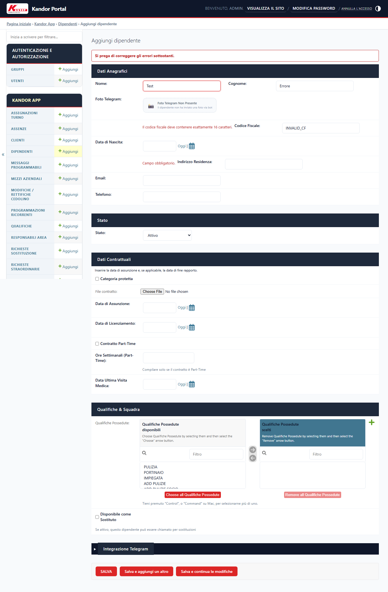
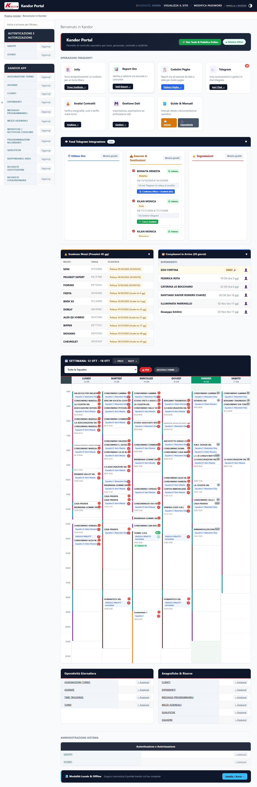
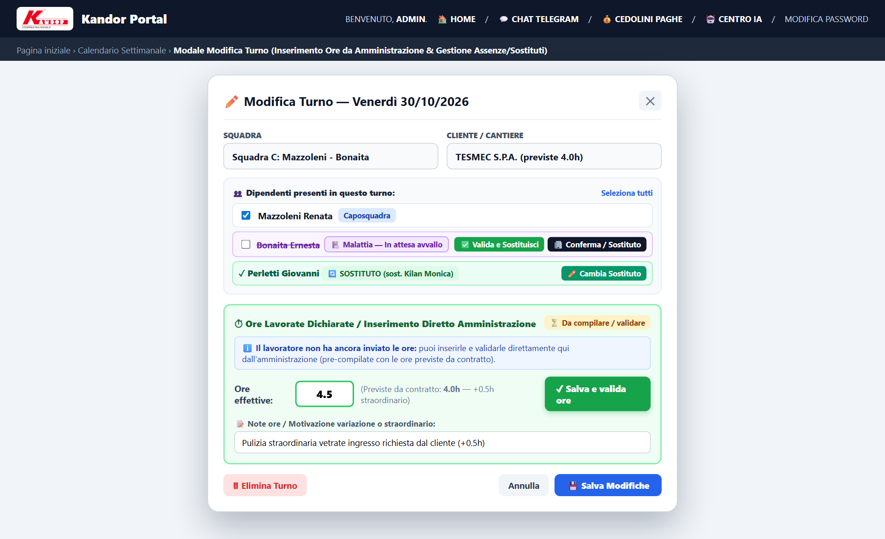
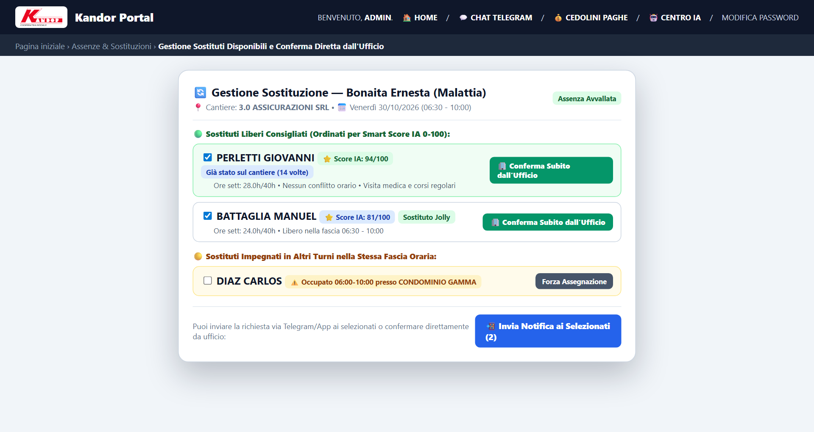
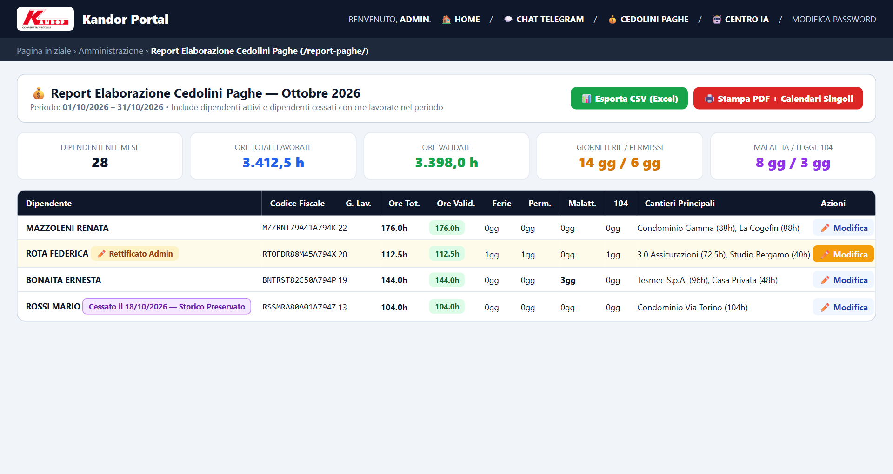
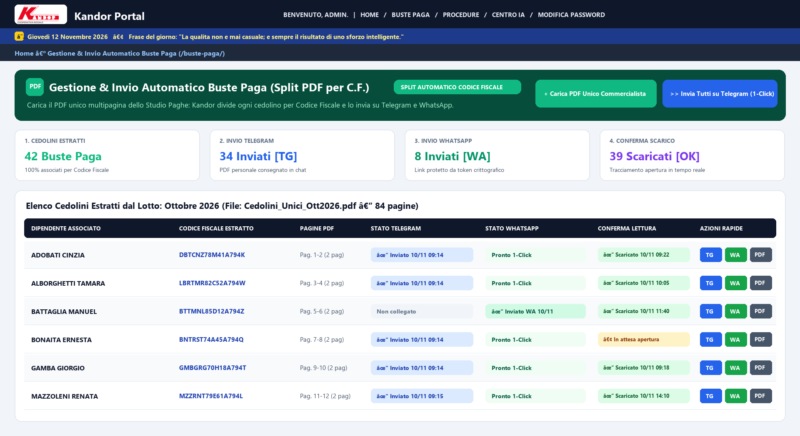
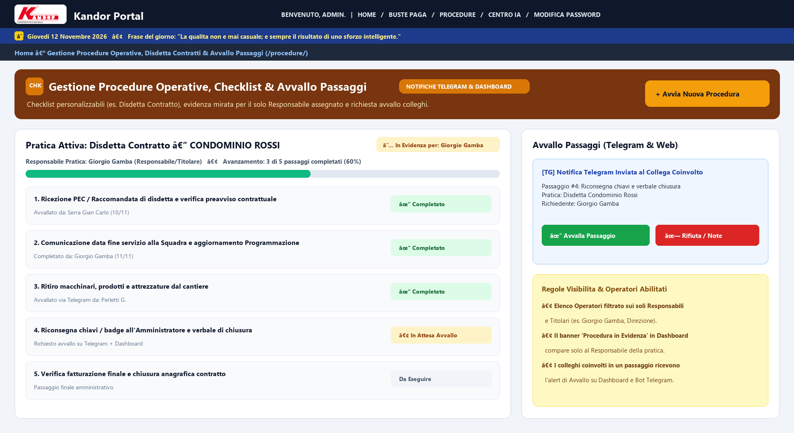
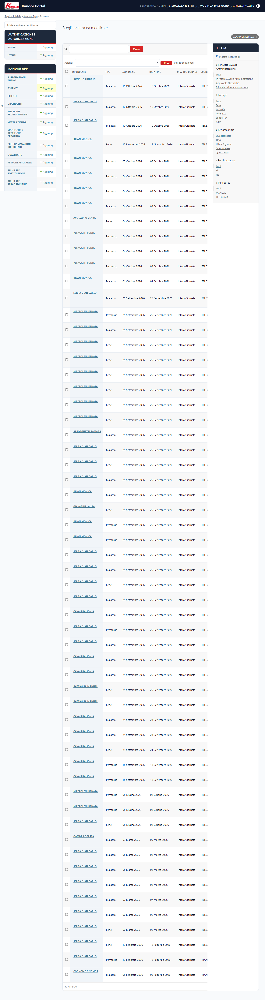
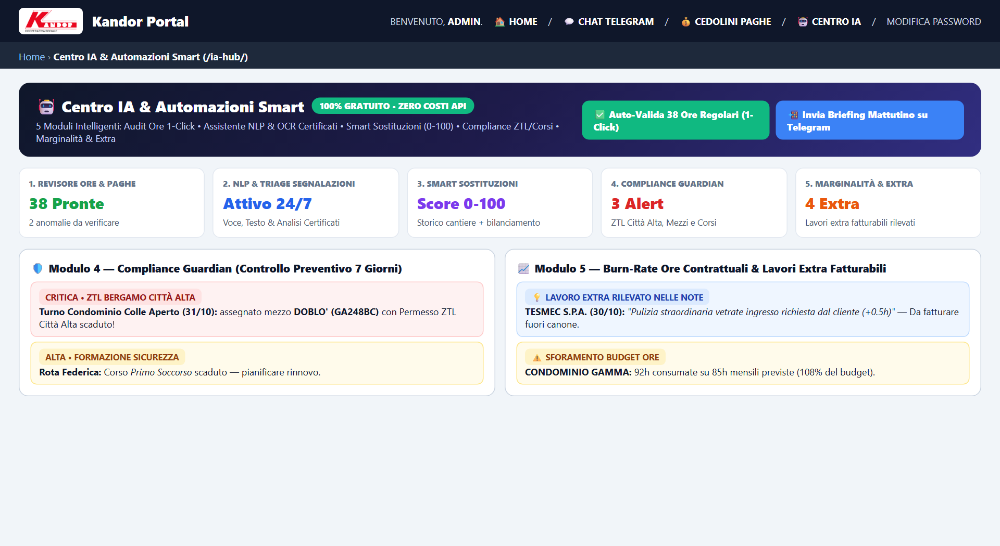
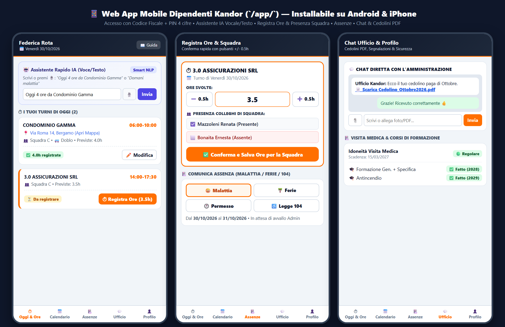

# 📘 KANDOR — Manuale d'Uso Completo e Guida Operativa

> **Versione**: 3.2  
> **Ultimo aggiornamento**: 12 Novembre 2026 (Sezione Buste Paga `/buste-paga/` con Split Automatico PDF per Codice Fiscale e Invio Telegram/WhatsApp, Gestione Procedure Operative `/procedure/` con Avvallo Passaggi su Telegram/Dashboard ed Evidenza per solo Responsabile, Barra Superiore con Data e Frase Positiva Giornaliera 365gg, Tabella Interattiva Calendario Cedolino in Report Paghe, Sostituzione Parziale su Giorni Specifici e Forzatura Sostituti Occupati/Senza Telegram, Validazione Ore Individuale e Campo Motivazione Dinamico, Finestra Turni 31 Giorni, Flag Rapidi `DISP. SOST.` e `RIC.NOT.` 1-Click, Auto-Login WhatsApp Dipendenti, Centro IA `/ia-hub/`)  
> **Applicazione Web Gestionale (VPS 24/7)**: [kandor.187.126.30.207.sslip.io](https://kandor.187.126.30.207.sslip.io)  
> **Gestione & Invio Buste Paga**: [kandor.187.126.30.207.sslip.io/buste-paga/](https://kandor.187.126.30.207.sslip.io/buste-paga/)  
> **Gestione Procedure & Checklist**: [kandor.187.126.30.207.sslip.io/procedure/](https://kandor.187.126.30.207.sslip.io/procedure/)  
> **Centro IA & Automazioni Smart**: [kandor.187.126.30.207.sslip.io/ia-hub/](https://kandor.187.126.30.207.sslip.io/ia-hub/)  
> **Web App Mobile Dipendenti**: [kandor.187.126.30.207.sslip.io/app/](https://kandor.187.126.30.207.sslip.io/app/)  
> **Sistema ERP per Imprese di Pulizie e Facility Management**

---

## 📋 Sommario Generale

1. [Introduzione e Architettura di Sistema](#1-introduzione-e-architettura-di-sistema)
2. [Accesso al Sistema, Barra Frase del Giorno e Sicurezza](#2-accesso-al-sistema-barra-frase-del-giorno-e-sicurezza)
3. [Dashboard Principale e Navigazione](#3-dashboard-principale-e-navigazione)
4. [Gestione Anagrafica Dipendenti, Flag 1-Click (`DISP. SOST.` / `RIC.NOT.`), WhatsApp Auto-Login e Corsi](#4-gestione-anagrafica-dipendenti-flag-1-click-disp-sost--ricnot-whatsapp-auto-login-e-corsi)
5. [Gestione Anagrafica Clienti e Sedi](#5-gestione-anagrafica-clienti-e-sedi)
6. [Gestione Qualifiche e Competenze](#6-gestione-qualifiche-e-competenze)
7. [Gestione Parco Mezzi Aziendali e Permessi ZTL](#7-gestione-parco-mezzi-aziendali-e-permessi-ztl)
8. [Gestione Squadre Operative e Propagazione Retroattiva Mese Corrente](#8-gestione-squadre-operative-e-propagazione-retroattiva-mese-corrente)
9. [Gestione Responsabili Area (RA)](#9-gestione-responsabili-area-ra)
10. [Pianificazione Turni, Calendario Settimanale e Finestra Modale Turno](#10-pianificazione-turni-calendario-settimanale-e-finestra-modale-turno)
11. [Programmazione Ricorrente Contratti](#11-programmazione-ricorrente-contratti)
12. [Richieste e Interventi Straordinari](#12-richieste-e-interventi-straordinari)
13. [Gestione Sostituti, Smart Score IA (0–100), Sostituzione Parziale per Giorni e Salto Turno](#13-gestione-sostituti-smart-score-ia-0100-sostituzione-parziale-per-giorni-e-salto-turno)
14. [Registrazione Ore (Time Tracking), Motivazione Dinamica, Conferma Squadra e Validazione Individuale/1-Click](#14-registrazione-ore-time-tracking-motivazione-dinamica-conferma-squadra-e-validazione-individuale1-click)
15. [Verifica Ore Mensili e Riconciliazione Storica](#15-verifica-ore-mensili-e-riconciliazione-storica)
16. [Report Paghe, Calendario Cedolino Interattivo, AI Revisore Ore e Rettifiche Amministrative](#16-report-paghe-calendario-cedolino-interattivo-ai-revisore-ore-e-rettifiche-amministrative)
17. [Buste Paga Automatiche (`/buste-paga/`) — Split PDF per Codice Fiscale e Invio Telegram/WhatsApp](#17-buste-paga-automatiche-buste-paga--split-pdf-per-codice-fiscale-e-invio-telegramwhatsapp)
18. [Gestione Procedure Operative (`/procedure/`), Disdetta Contratti, Checklist e Avvallo Passaggi](#18-gestione-procedure-operative-procedure-disdetta-contratti-checklist-e-avvallo-passaggi)
19. [Gestione Assenze, Avvallo e Sostituzioni Automatiche](#19-gestione-assenze-avvallo-e-sostituzioni-automatiche)
20. [Segnalazioni dagli Operatori e Triage Automatico IA](#20-segnalazioni-dagli-operatori-e-triage-automatico-ia)
21. [Riconciliazione Ore e Monitoraggio Cantieri](#21-riconciliazione-ore-e-monitoraggio-cantieri)
22. [Analisi Economica Contratti e Marginalità](#22-analisi-economica-contratti-e-marginalita)
23. [Centro IA & Automazioni Smart (`/ia-hub/`) — I 5 Moduli a Costo Zero](#23-centro-ia--automazioni-smart-ia-hub--i-5-moduli-a-costo-zero)
24. [Web App Mobile per Dipendenti (`/app/`), Auto-Login WhatsApp, PIN 4 Cifre e Assistente Vocale IA](#24-web-app-mobile-per-dipendenti-app-auto-login-whatsapp-pin-4-cifre-e-assistente-vocale-ia)
25. [Integrazione Bot Telegram e Linguaggio Naturale IA per Lavoratori](#25-integrazione-bot-telegram-e-linguaggio-naturale-ia-per-lavoratori)
26. [Messaggi Programmati e Comunicazioni di Massa](#26-messaggi-programmati-e-comunicazioni-di-massa)
27. [Centro Messaggi Unificato (Web App + Telegram) e Invio Allegati](#27-centro-messaggi-unificato-web-app--telegram-e-invio-allegati)
28. [Gestione Dati, Import/Export Excel e Backup](#28-gestione-dati-importexport-excel-e-backup)
29. [Widget Dashboard e Monitoraggio Scadenze](#29-widget-dashboard-e-monitoraggio-scadenze)
30. [FAQ, Risoluzione Problemi e Domande Frequenti](#30-faq-risoluzione-problemi-e-domande-frequenti)

---

## 1. Introduzione e Architettura di Sistema

### Scopo del Sistema
**KANDOR** è una piattaforma ERP (Enterprise Resource Planning) verticale appositamente progettata per coprire l'intero ciclo operativo di un'impresa di pulizie e servizi integrati (facility management). Il software unisce in un unico ambiente le esigenze contabili dell'amministrazione, l'automazione intelligente tramite Intelligenza Artificiale a costo zero, la distribuzione automatizzata delle buste paga, le checklist procedurali con avvallo e le necessità quotidiane dei responsabili di cantiere e dei lavoratori sul campo.

Con Kandor l'azienda ottiene:
- **Pianificazione automatizzata dei turni**: Trasformazione dei contratti cliente in calendarizzazioni settimanali o mensili senza inserimenti manuali ripetitivi, ottimizzata in modalità *bulk* ad altissima velocità anche per contratti pluriennali o a tempo indeterminato.
- **Supporto ai contratti storici e in essere**: Generazione retroattiva dei turni passati con marcatura automatica delle ore in attesa di conferma e propagazione retroattiva dal 1° del mese corrente quando si aggiunge un componente alla squadra.
- **Triplo Canale Mobile per i Dipendenti (Web App `/app/` + Bot Telegram + Link Diretti WhatsApp)**: Gli operatori registrano le ore (anche con dettatura vocale IA e finestra storica di **31 giorni**), motivano eventuali variazioni orarie, confermano i compagni di squadra, ricevono le buste paga o segnalano assenze sia tramite la Web App Mobile (con PIN di 4 cifre o link di **Auto-Login 1-Click via WhatsApp**) sia tramite Bot Telegram.
- **Gestione & Invio Automatico Buste Paga (`/buste-paga/`)**: Caricamento dell'unico file PDF multipagina fornito dal commercialista/consulente del lavoro, **divisione (split) automatica in singoli PDF per Codice Fiscale**, associazione automatica ai dipendenti e **invio massivo 1-Click su Telegram e WhatsApp** con conferma di lettura/scaricamento in tempo reale.
- **Gestione Procedure Operative, Disdette e Checklist con Avvallo (`/procedure/`)**: Gestione strutturata delle procedure aziendali (es. *Disdetta Contratto Cliente*) assegnate ai soli Responsabili/Titolari, con banner in evidenza mirato per il solo responsabile della pratica e richiesta di **Avvallo / Conferma dei singoli passaggi ai colleghi** su Telegram e Dashboard.
- **Centro IA & Automazioni Smart a Costo Zero (`/ia-hub/`)**: Cinque motori algoritmici ed euristici integrati direttamente nel codice Python/Django (senza alcun abbonamento esterno né costi a consumo) per:
  1. **AI Revisore Ore & Auto-Validazione 1-Click** delle timbrature regolari (con esclusione automatica delle ore già validate dalle anomalie);
  2. **Assistente Conversazionale NLP (Testo/Voce), Lettura Certificati/Documenti e Triage Segnalazioni**;
  3. **Smart Sostituzioni Predittive (Ranking 0–100)** basate su storico presenze sul cantiere, distanza km, monte ore settimanale, tasso di risposta e idoneità corsi/visita medica;
  4. **Compliance Guardian & Briefing Mattutino** (controllo preventivo permessi ZTL Bergamo Città Alta, mezzi, visite mediche e corsi speciali richiesti dal cantiere);
  5. **Controllo Marginalità, Burn-Rate e Lavori Extra Fatturabili** estratti automaticamente dalle note di fine turno.
- **Gestione Avvallo Assenze e Sostituzioni Flessibili**: Ricerca sostituti con selezione di **giorni specifici per sostituzioni parziali**, possibilità di **forzare sostituti occupati o senza Telegram**, selezione diretta del sostituto alla deselezione del dipendente nella scheda turno e gestione **"Non Sostituito (Salto Turno)"**.
- **Elaborazione Prospetto Paghe con Calendario Cedolino Interattivo**: Report mensile per lo studio di consulenza del lavoro con tabella calendario giornaliera espandibile cliccando sul nome del dipendente, audit IA pre-busta paga e rettifiche amministrative.

### Requisiti Tecnici e Infrastruttura VPS Dedicata 24/7
- **Infrastruttura Server**: Server Cloud **VPS dedicato SerraStudio** (`https://kandor.187.126.30.207.sslip.io`) con database **PostgreSQL 16** dedicato e Webhook Telegram attivo in tempo reale **24 ore su 24, 7 giorni su 7** (zero tempi di attesa o sospensione).
- **Browser consigliati**: Google Chrome, Mozilla Firefox, Microsoft Edge o Apple Safari (versione aggiornata).
- **Dispositivi Mobili**: Qualsiasi smartphone Android o iOS tramite browser (`https://kandor.187.126.30.207.sslip.io/app/`), WhatsApp e/o l'app gratuita Telegram (`@kandor_gestionale_bot`).

---

## 2. Accesso al Sistema, Barra Frase del Giorno e Sicurezza

### Accesso alla Piattaforma Cloud VPS
L'indirizzo ufficiale per accedere al gestionale da qualsiasi postazione web o mobile è:
👉 **[https://kandor.187.126.30.207.sslip.io](https://kandor.187.126.30.207.sslip.io)**

Qualora l'utente non sia ancora autenticato, il sistema reindirizzerà automaticamente alla pagina di Login protetta.

### Barra Superiore con Data del Giorno e Frase Positiva Giornaliera (365 Giorni)
Subito sotto l'intestazione principale di **Kandor Portal**, in tutte le pagine del gestionale è presente la **Barra del Giorno**, che visualizza automaticamente:
- 📅 **La Data Odierna completa in italiano** (es. *Giovedì 12 Novembre 2026*).
- ✨ **La Frase Positiva Giornaliera**: un pensiero motivazionale e positivo diverso per ciascuno dei **365 giorni dell'anno**, selezionato automaticamente in base al giorno corrente per accompagnare il lavoro quotidiano del team.

### Avvio Rapido su Installazione Locale (Desktop)
In presenza di installazione locale sulla macchina aziendale:
1. Apri la cartella del progetto e fai doppio click sul file **`kandor_avvia.pyw`** (o in alternativa esegui il file **`start_app.bat`**).
2. Il server locale si avvia istantaneamente e apre in automatico il browser all'indirizzo **`http://127.0.0.1:8000/`**.

### Procedura di Login e Modifica Password
1. Digita il tuo **Nome utente** e la **Password** nei rispettivi campi e clicca su **"Accedi"**.
2. Per modificare la password, clicca in alto a destra su **"Modifica password"**, inserisci la password attuale e due volte la nuova password, quindi conferma.

### Controllo Validazione e Gestione Errori nei Form
Durante l'inserimento o la modifica dei dati (anagrafiche dipendenti, clienti, mezzi, assenze, turni):
- **Evidenziazione Diretta dell'Errore**: In caso di dati errati, incompleti o duplicati (es. Codice Fiscale errato, Targa già esistente, date di licenziamento antecedenti all'assunzione), il sistema **non mostra mai schermate di errore generico (500)** e **non disconnette l'utente**.
- **Banner Informativo e Conservazione Dati**: Viene visualizzato un banner rosso in cima al form con il dettaglio dell'errore. L'utente rimane all'interno della pagina corrente mantenendo tutti i campi già compilati per poter effettuare immediatamente le correzioni necessarie.
- **Sanitizzazione Automatica**: I Codici Fiscali, le Partite IVA e le Targhe dei veicoli vengono automaticamente puliti da spazi bianchi superflui e convertiti in caratteri maiuscoli al momento del salvataggio.

---

## 3. Dashboard Principale e Navigazione

La Dashboard di Kandor costituisce il centro di controllo di tutte le attività operative.

### Layout della Schermata
- **Barra Superiore Istituzionale e Frase del Giorno**: Mostra il logo Kandor, l'utente connesso, la **Data del Giorno con la Frase Positiva Giornaliera (365gg)** e i collegamenti rapidi.
- **Banner Prioritario "Procedure & Richieste di Avvallo in Evidenza"**: Compare automaticamente in cima alla Dashboard quando l'utente loggato è il **Responsabile assegnato** a una procedura in evidenza oppure quando un collega gli ha richiesto l'**Avvallo di un passaggio operativo** (con bottone di approvazione immediata 1-Click).
- **Griglia "Operazioni Frequenti" (Accesso Diretto 1-Click)**:
  - 🏥 **Jolly (`Trova Sostituto`)**: Ricerca rapida sostituti per cantiere con **Smart Score IA (0–100)**.
  - 📊 **Report Ore (`Vedi Report`)**: Verifica e convalida ore mensili e consuntivi con PDF.
  - 📋 **Cedolini Paghe (`Elabora Paghe`)**: Prospetto ore ed assenze per studio paghe con calendario giornaliero interattivo e AI Revisore Ore.
  - 📄 **Buste Paga (`Invia Buste Paga` — `/buste-paga/`)**: Split automatico del PDF unico del commercialista per Codice Fiscale e invio massivo/singolo su Telegram e WhatsApp.
  - 💬 **Chat & Telegram (`Apri Chat`)**: Centro messaggi bidirezionale unificato (Telegram + Web App) con contatore messaggi non letti.
  - 📲 **App Dipendenti (`Apri Web App` — `/app/`)**: Accesso alla Web App Mobile per cellulare.
  - 💰 **Analisi Contratti (`Analizza`)**: Verifica marginalità, costi e tariffe orarie €/ora.
  - 📋 **Procedure (`Gestisci Procedure` — `/procedure/`)**: Checklist operative, disdetta contratti e gestione passaggi con avvallo colleghi.
  - 💾 **Gestione Dati (`Gestisci`)**: Importazione, esportazione Excel/CSV e backup database.
  - 🤖 **Centro IA & Smart (`Apri Centro IA` — `/ia-hub/`)**: Console dei 5 moduli di Intelligenza Artificiale a costo zero.
  - 📘 **Guide & Manuali**: Pulsanti rapidi per scaricare il **Manuale Admin PDF (`📖 Admin PDF`)**, consultare il **Manuale Web Online (`🌐 Admin Web`)** e aprire la **Guida Dipendente (`📱 Dipendente`)**.
- **Feed Operativo e Widget Scadenze**: Mostra il flusso live delle comunicazioni da Telegram/Web App e i 4 widget affiancati per **Scadenze Mezzi & ZTL**, **Scadenze Visite Mediche**, **Scadenze Corsi di Formazione** e **Compleanni in Arrivo**, seguiti dai **Contratti in Scadenza** e dal **Calendario Interattivo della Programmazione Settimanale**.

---

## 4. Gestione Anagrafica Dipendenti, Flag 1-Click (`DISP. SOST.` / `RIC.NOT.`), WhatsApp Auto-Login e Corsi

### Scopo Operativo
Il modulo Dipendenti censisce tutti i lavoratori aziendali, raccogliendo le informazioni anagrafiche, le credenziali di accesso alla Web App Mobile (**Codice Fiscale + PIN di 4 cifre** + **Link Auto-Login WhatsApp**), lo stato di collegamento Telegram/WhatsApp, i flag rapidi modificabili con 1 click in tabella, le qualifiche professionali, la sorveglianza sanitaria e i 10 corsi di formazione obbligatori.

### Percorso di Navigazione
👉 **Dashboard** → **Dipendenti** (oppure `/admin/core/dipendente/`)

### Novità nella Tabella Elenco Dipendenti (Filtri e Azioni 1-Click)
Aprendo la lista **Dipendenti**, l'interfaccia offre strumenti rapidi per lavorare senza dover aprire ogni singola scheda:
1. **Filtro Predefinito "Solo Dipendenti Attivi"**:
   - Di default la lista mostra **esclusivamente i Dipendenti Attivi**, mantenendo la schermata pulita e veloce.
   - In alto sopra la tabella è presente il selettore rapido per visualizzare con un click: **`🟢 Solo Attivi (Default)`**, **`🔴 Solo Inattivi / Licenziati`** oppure **`👥 Tutti i Dipendenti`**.
2. **Indicatori Stato Collegamento Telegram (`✈️`) e WhatsApp/WebApp (`📱`) + Invio WhatsApp 1-Click**:
   - Nella colonna **`🔑 PIN & App`**, subito **a sinistra del PIN di 4 cifre**, sono presenti due indicatori luminosi che mostrano a colpo d'occhio se il lavoratore ha **Telegram collegato** e se ha il **numero di telefono/WebApp attivo**.
   - Cliccando sul pulsante verde **WhatsApp 1-Click (`💬`)**, si apre WhatsApp con un messaggio già pronto per il lavoratore contenente il suo PIN e il **Link personale di Auto-Login diretto**: toccando quel link sul proprio smartphone, il dipendente entra direttamente nella Web App Mobile (`/app/`) già autenticato!
3. **Colonna `DISP. SOST.` (Flag Sostituto Cliccabile con 1 Click)**:
   - Nella tabella Dipendenti, la disponibilità del lavoratore come **Sostituto (Jolly)** è modificabile con **un solo click direttamente sulla riga**: il salvataggio avviene istantaneamente in background senza ricaricare la pagina.
4. **Colonna `RIC.NOT.` (Flag "Riceve Notifiche Messaggi — Solo Responsabili" Cliccabile con 1 Click)**:
   - La colonna abbreviata **`RIC.NOT.`** permette di attivare o disattivare con **1 click** direttamente dalla lista Dipendenti il flag *"Riceve notifiche messaggi (Solo Responsabili)"*, stabilendo quali responsabili ricevono gli avvisi automatici su Telegram per i messaggi e le segnalazioni dei lavoratori.

### Guida Passo-Passo per l'Inserimento e la Gestione di un Dipendente
1. Clicca su **Dipendenti** e poi sul pulsante in alto a destra **"+ Aggiungi Dipendente"**.
2. **Dati Anagrafici e Foto Profilo**:
   - Inserisci **Nome**, **Cognome** e facoltativamente la **Foto Profilo**.
   - Inserisci il **Codice Fiscale** (16 caratteri alfanumerici). Se lasci "Data di Nascita" vuoto, il sistema la ricava automaticamente dal Codice Fiscale.
   - Digita l'**Indirizzo di Residenza** completo: al salvataggio viene geocodificato automaticamente in coordinate GPS per il calcolo delle distanze dai cantieri.
3. **Contatti, Web App Mobile (PIN 4 cifre) e Telegram**:
   - Inserisci il **Telefono** (utilizzato anche per l'invio 1-Click su WhatsApp di credenziali App e Buste Paga) e l'**Email**.
   - **PIN Accesso App Mobile (4 cifre)**: generato automaticamente se lasciato vuoto; rigenerabile anche massivamente dal menu *Azione* **"🔑 Rigenera PIN 4 cifre (App Mobile)"**.
   - **Telegram Chat ID**: compilato automaticamente quando il dipendente avvia il bot `@kandor_gestionale_bot` o inseribile manualmente.
4. **Contratto Part-Time (`M` / `V` / `O`), Sostituzioni, Notifiche Responsabili (`RIC.NOT.`) e Visita Medica**:
   - **Contratto Part-Time**: spuntando **"Contratto Part-Time"** (`is_part_time`), seleziona il **Tipo Part-Time** obbligatorio tra **`M` (Misto)**, **`V` (Verticale)** o **`O` (Orizzontale)**.
   - **Disponibile come Sostituto** e **Riceve notifiche messaggi (`RIC.NOT.`)**: attivabili sia nella scheda sia con 1 click dalla tabella.
   - **Prossima scadenza visita medica**: attiva un alert automatico in Dashboard **20 giorni prima** della scadenza (con badge di stato scadenza formattato chiaramente anche nella scheda individuale del dipendente).
5. **Corsi di Formazione e Sicurezza (D.Lgs. 81/08) con Calcolo Automatico Scadenza**:
   - In fondo alla scheda sono presenti i **10 corsi di formazione standard** (*Corso sicurezza generale 5a*, *Corso Specifico Basso Rischio 5a*, *Movimentazione manuale dei carichi 5a*, *DPI 3 lavori in quota 5a*, *RLS 5a*, *Preposto 2a*, *Primo soccorso 3a*, *Piattaforme mobili PLE 5a*, *HACCP 5a*, *Antincendio livello 2 5a*).
   - Impostando **`✅ Fatto`** e la **Data di Esecuzione**, Kandor calcola **automaticamente la Data di Scadenza**.
6. **Stato Operativo, Data Licenziamento e Tutela dello Storico Cedolini**:
   - Passando un dipendente a **Inattivo** o inserendo la **Data di Licenziamento**, Kandor lo rimuove **soltanto dai turni futuri**, preservando integralmente tutti i turni passati, le ore lavorate e i cedolini storici.

---

## 5. Gestione Anagrafica Clienti e Sedi

### Scopo Operativo
Anagrafica di tutti i clienti o cantieri aziendali presso i quali si svolgono i servizi di pulizia o manutenzione.

### Percorso di Navigazione
👉 **Dashboard** → **Clienti** (oppure `/admin/core/cliente/`)

### Descrizione dei Campi Principali
- **Ragione Sociale**, **Partita IVA / Codice Fiscale**.
- **Indirizzo Sede / Cantiere**: geocodificato in coordinate GPS per il calcolo distanze e analizzato dal *Compliance Guardian IA* per rilevare i cantieri in **Bergamo Città Alta / ZTL**.
- **Nome Referente / Ruolo / Telefono / Data Nascita Referente**.
- **Ore Mensili Contratto** e **Importo Mensile Contratto (€)**: utilizzati per Riconciliazione Ore, Analisi Contratti e *Burn-Rate IA*.
- **Note / Mansioni Cantiere (`note_mansioni`)**: istruzioni operative e requisiti speciali verificati anche dal motore IA.
- **Sezioni Inline**: gestione diretta di **Programmazione Ricorrente** e **Richieste Straordinarie** dentro la scheda cliente.

---

## 6. Gestione Qualifiche e Competenze

### Scopo Operativo e Percorso
👉 **Dashboard** → **Qualifiche** (`/admin/core/qualifica/`)  
Definisce le competenze tecniche assegnabili ai dipendenti e richiedibili nei cantieri; il motore **Trova Jolly** filtra automaticamente i candidati in base alle qualifiche obbligatorie previste dal turno.

---

## 7. Gestione Parco Mezzi Aziendali e Permessi ZTL

### Scopo Operativo e Percorso
👉 **Dashboard** → **Mezzi Aziendali** (`/admin/core/mezzo/`)

### Descrizione dei Campi e Monitoraggio Scadenze
- **Modello Mezzo**, **Targa**, **Stato Attuale** (*Disponibile*, *In Manutenzione*, *Guasto / Fuori Uso*), **Km Percorsi**.
- **Scadenze & Permessi**: **Scadenza Polizza Assicurativa**, **Scadenza Bollo**, **Scadenza Revisione**, **Scadenza Permesso Città Alta (ZTL)** e **Numero Permesso Città Alta**.
- **Badge Semaforici e Compliance Guardian IA**: ogni scadenza mostra un badge 🟢 Verde (>30gg), 🟠 Arancione (`⚠️ Xgg`) o 🔴 Rosso (`SCADUTA`), incrociato preventivamente con i turni in ZTL Città Alta.

---

## 8. Gestione Squadre Operative e Propagazione Retroattiva Mese Corrente

### Scopo Operativo e Percorso
👉 **Dashboard** → **Squadre** (`/admin/core/squadra/`)

### Configurazione, Propagazione Ore dal 1° del Mese e Protezione Storico
1. **Nome Squadra**, **Caposquadra**, **Componenti** e **Responsabile Area Collegato**.
2. **Novità — Propagazione Retroattiva Automatica dal 1° del Mese Corrente**:
   - Quando aggiungi un nuovo componente a una Squadra Operativa durante il mese, Kandor **aggiorna automaticamente i turni della squadra a partire dal 1° giorno del mese corrente** e **propaga retroattivamente al nuovo componente le ore già dichiarate/validate per quei turni**, così il cedolino del mese corrente risulta subito allineato senza dover reinserire le ore giorno per giorno!
3. **Protezione Totale dei Mesi Precedenti e delle Squadre Eliminate**:
   - I mesi precedenti già chiusi non vengono mai toccati dalle modifiche alla squadra.
   - Se una squadra viene eliminata, vengono rimossi solo i turni futuri mentre tutti i turni passati e i `TimeTracking` storici restano intatti.

---

## 9. Gestione Responsabili Area (RA)

### Scopo Operativo e Percorso
👉 **Dashboard** → **Responsabili Area** (`/admin/core/responsabilearea/`)  
Coordina le squadre assegnate a ciascun Responsabile Area e definisce i **Responsabili / Titolari abilitati** anche nella sezione **Procedure Operative (`/procedure/`)** (dove l'elenco operatori è riservato esclusivamente ai responsabili e titolari, come *Giorgio Gamba* e la Direzione).

---

## 10. Pianificazione Turni, Calendario Settimanale e Finestra Modale Turno

### Scopo Operativo e Percorso
👉 **Dashboard** → **Pianificazione Settimanale** (Calendario Interattivo) oppure **Turni**

### Navigazione Rapida Mese/Settimana e Mini-Calendario Mensile (`🗓️ Mese ▾`)
- **Selettore Mese (`📅 Novembre 2026 ▾`)** e **Selettore Settimana (`Sett: ... ▾`)** per saltare istantaneamente a qualsiasi settimana dell'anno.
- **Mini-Calendario Mensile Popover (`🗓️ Mese ▾`)**: griglia mensile interattiva Lunedì–Domenica che mantiene attivo l'eventuale filtro per Squadra.
- **Badge Semaforici sulle Card Turno**:
  - 🟢 **Verde (`✔ Xh`)**: Ore validate dall'amministrazione.
  - 🟡 **Giallo / Ambra (`⏳ Xh`)**: Ore inviate dal lavoratore in attesa di convalida.
  - 🔴 **Rosso (`! Ore mancanti`)**: Turno passato privo di consuntivo ore.
  - 🟣 **Viola (`🏥 Malattia` / `🏖️ Ferie` / `🕐 Permesso` / `♿ Legge 104`)**: Componente assente.
  - 🔴 **Badge Rosso `⏭️ Non Sostituito (Salto Turno)`**: Turno in cui si è deciso di non inviare un sostituto, con motivazione visibile.

### Finestra Modale "✏️ Modifica Turno": Barra di Scorrimento, Sostituto Diretto alla Deselezione e Validazione Ore Individuale
Cliccando su qualsiasi card turno nel Calendario Settimanale si apre la finestra modale **"✏️ Modifica Turno"**, potenziata con:
1. **Barra di Scorrimento Laterale Dedicata**:
   - La finestra del turno integra una comoda **barra di scorrimento verticale (`scrollbar`)** che permette di visualizzare e gestire agevolmente anche squadre numerose, sostituti e note senza mai uscire dai bordi dello schermo.
2. **Selezione Diretta del Sostituto alla Deselezione di un Dipendente (Senza Obbligo di Validare prima l'Assenza)**:
   - Nella sezione **"👥 Dipendenti presenti in questo turno"**, non appena **togli la spunta (deselezioni)** a un dipendente della squadra, compare immediatamente il selettore rapido per **scegliere e assegnare direttamente il suo Sostituto** per quel turno, anche se non è stata ancora inserita o avvallata una pratica formale di assenza!
3. **Pulsanti Rapidi per Assenze Registrata**:
   - Se invece il dipendente ha un'assenza registrata, compaiono i pulsanti **`✅ Valida e Sostituisci`**, **`👥 Scegli Sostituto`** e **`🏢 Conferma / Sostituto`**.
4. **Inserimento e Validazione Ore (Di Squadra o Individuale per Singolo Dipendente) + Motivazione Dinamica**:
   - Anche se il lavoratore non ha inviato le ore da app/Telegram, l'amministrazione può inserirle e validarle direttamente nella sezione **"⏱ Ore Lavorate Dichiarate / Inserimento Diretto Amministrazione"**.
   - **Validazione Individuale per Dipendente**: È possibile inserire e convalidare le ore anche **individualmente per ciascun singolo dipendente** del turno (utile quando un componente o un sostituto ha svolto un orario diverso dal resto della squadra), senza creare duplicazioni.
   - **Campo Motivazione Opzionale Dinamico**: Quando il numero di ore inserito è **diverso dalle ore previste** per il turno (in eccesso o in difetto), il sistema mostra dinamicamente il campo per annotare la **motivazione della variazione oraria** (es. *"Straordinario pulizia vetrate +1h"* o *"Uscita anticipata concordata"*).

---

## 11. Programmazione Ricorrente Contratti

### Scopo Operativo e Percorso
👉 **Scheda Cliente** → Sezione **Programmazione Ricorrente** (`/admin/core/programmazionericorrente/`)
- Configura ripetizioni **Giornaliere/Settimanali**, **Bisettimanali** o **Mensili**, con calcolo automatico dell'**Ora Fine** a partire da *Ora Inizio + Durata*.
- **Generazione Turni Bulk Ultra-Veloce**: il motore di generazione turni utilizza operazioni *bulk* ottimizzate sul database PostgreSQL, generando istantaneamente le pianificazioni anche per contratti con scadenza oltre il 2026 o a tempo indeterminato senza alcun rallentamento.

---

## 12. Richieste e Interventi Straordinari

### Scopo Operativo e Percorso
👉 **Scheda Cliente** → Sezione **Richieste Straordinarie**  
Gestisce gli interventi extra-capitolato o una tantum (lavaggio vetrate, post-cantiere, sanificazioni) con date, orari, descrizione lavori, squadra assegnata e spunta di completamento.

---

## 13. Gestione Sostituti, Smart Score IA (0–100), Sostituzione Parziale per Giorni e Salto Turno

### Scopo Operativo e Percorso
👉 **Calendario Turni** → Clicca sul turno → **"🔄 Trova Sostituto"** oppure **Operazioni Frequenti → Jolly** (`/find-jolly/`)

### Come Funziona lo Smart Score IA (0–100)
Ogni candidato sostituto viene valutato con un punteggio predittivo da **0 a 100** che combina:
1. ⭐ **Conoscenza storica del Cantiere** (fino a +30 pt);
2. 📍 **Vicinanza Geografica GPS in km** (fino a +25 pt);
3. ⚖️ **Equilibrio Monte Ore Settimanale** (fino a +15 pt);
4. ⚡ **Affidabilità e Tasso di Risposta storico** (fino a +15 pt);
5. 🛡️ **Idoneità Visita Medica e Corsi Sicurezza**.

### Novità 1 — 📅 Selezione Giorni Specifici per Sostituzione Parziale
Quando un dipendente è assente per più giorni consecutivi (es. 5 giorni di malattia o 2 settimane di ferie), non sempre un unico sostituto può coprire l'intero periodo:
- Nel modale **Seleziona Sostituti**, l'amministrazione visualizza l'**elenco delle singole giornate di turno scoperte** con relative caselle di spunta (`checkbox`).
- È possibile **selezionare solo i giorni specifici** da affidare a un determinato sostituto (ad esempio Lunedì e Mercoledì al Sostituto A, e Venerdì al Sostituto B), gestendo con estrema precisione le **sostituzioni parziali**!
- Inoltre il modale mantiene correttamente la **pre-selezione dei candidati** consigliati per velocizzare l'invio delle notifiche o la conferma d'ufficio.

### Novità 2 — 🔓 Forzatura Selezione Sostituti Occupati o Senza Telegram
In situazioni d'urgenza l'amministrazione può aver bisogno di assegnare un lavoratore che risulta già impegnato in un altro turno nella giornata oppure che non utilizza Telegram (contattato telefonicamente o via WhatsApp):
- Il modale sostituti permette all'ufficio di **selezionare e forzare l'assegnazione anche di sostituti già occupati o privi di Telegram**, mostrando chiaramente il relativo avviso informativo ma lasciando piena libertà decisionale all'amministratore.

### Gestione "⏭️ Non Sostituito (Salto Turno)"
Se l'ufficio decide di non inviare alcun sostituto per un turno scoperto, basta cliccare su **"⏭️ Non Sostituito (Salto Turno)"** e inserire la motivazione: il turno verrà marcato sul calendario in rosso con il nome dell'assente e la nota inserita.

---

## 14. Registrazione Ore (Time Tracking), Motivazione Dinamica, Conferma Squadra e Validazione Individuale/1-Click

### Tre Canali Sincronizzati e Finestra Estesa a 31 Giorni
1. **Via Web App Mobile (`/app/` — Fonte `WEBAPP`)**: L'operatore inserisce le ore di oggi o recupera i **turni non compilati degli ultimi 31 giorni** (e consulta l'elenco dei turni già compilati negli ultimi 31 giorni).
2. **Via Bot Telegram (`@kandor_gestionale_bot` — Fonte `TELEGRAM`)**:Tramite i bottoni `⏱ Registra Ore` / `📋 Turni Non Compilati` (fino a **31 giorni** indietro) o scrivendo in linguaggio naturale.
3. **Inserimento Diretto Admin (`ADMIN`)**: Dal modale del turno sul calendario o da `Time Tracking`.

### Novità — 📝 Campo Motivazione Opzionale Dinamico per Ore Diverse dal Previsto
Quando il lavoratore (nella Web App Mobile o su Telegram) oppure l'amministratore inserisce un **numero di ore diverso da quello previsto dal turno** (es. `4.5h` invece di `4.0h`, oppure `2.0h` invece di `3.0h`):
- Compare automaticamente un **campo dinamico per la motivazione (opzionale)** che invita a specificare il motivo della differenza oraria (es. *"Richiesto lavaggio extra scale"*, *"Cantiere chiuso prima"*).
- La motivazione viene salvata direttamente nelle note del `TimeTracking` ed è subito visibile all'amministrazione sul calendario, nel Report Paghe e nel modulo *Lavori Extra Fatturabili* del Centro IA.

### Conferma Compagni di Squadra e Validazione Individuale / 1-Click
- Il primo componente della squadra che registra le ore conferma con una spunta i compagni presenti, propagando automaticamente le ore provvisorie.
- L'amministrazione può **validare le ore singolarmente per ciascun dipendente** nella finestra del turno oppure usare il pulsante **"⚡ Auto-Valida Ore Regolari (1-Click)"** per approvare in blocco tutte le timbrature regolari del mese. Le ore già validate vengono automaticamente escluse dalle segnalazioni di anomalia del Centro IA e protette da duplicazioni.

---

## 15. Verifica Ore Mensili e Riconciliazione Storica

### Scopo Operativo e Percorso
👉 **Operazioni Frequenti** → **Report Ore (`Vedi Report`)** (`/verifica-ore/`)  
Mostra per qualsiasi mese/anno:
- **Tabella 1**: Riepilogo per Cliente (Ore Contratto vs Ore Lavorate e Validate).
- **Tabella 2**: Riepilogo per Squadra e Dipendente.
- **Tabella 3**: Riepilogo Assenze del Mese espandibile per dipendente.
- Pulsante **"📄 Scarica PDF"** per generare il report stampabile.

---

## 16. Report Paghe, Calendario Cedolino Interattivo, AI Revisore Ore e Rettifiche Amministrative

### Scopo Operativo e Percorso
👉 **Operazioni Frequenti** → **Cedolini Paghe (`Elabora Paghe`)** (`/report-paghe/`)

### Novità — 🗓️ Tabella Interattiva "Calendario Cedolino Giornaliero" per Ogni Dipendente
Nella pagina **Report Paghe (`/report-paghe/`)**, oltre ai totali mensili di giorni lavorati, ore ordinarie/validate e assenze:
- **Il nome di ciascun dipendente è cliccabile** (così come il pulsante dettaglio calendario sulla riga).
- Cliccando sul nome del dipendente si apre a comparsa, subito sotto la sua riga, la **Tabella Interattiva del Calendario Cedolino Mensile (dal giorno 1 al giorno 31 del mese)**:
  - Per ogni singolo giorno del mese mostra il **giorno della settimana**, le **ore lavorate**, il dettaglio dei **cantieri/clienti** svolti e gli eventuali codici di **assenza** (*Ferie*, *Malattia*, *Permesso*, *104*).
  - I dati del calendario giornaliero vengono inizializzati sia per la consultazione immediata nella dashboard web sia per la generazione del **PDF ufficiale per il Consulente del Lavoro (`📄 Stampa PDF Paghe`)** e l'esportazione **CSV/Excel**.

### Banner "🕵️‍♂️ AI Revisore Ore & Auto-Validazione 1-Click" e Rettifica Cedolino (`✏️ Rettifica`)
- In cima alla pagina, il banner **AI Revisore Ore** permette di approvare con **1 click** tutte le ore regolari del periodo e segnala solo le anomalie reali (escludendo automaticamente i turni già validati dall'amministrazione).
- Cliccando su **`✏️ Rettifica`** accanto a un dipendente è possibile impostare gli *override* amministrativi su giorni lavorati, ore totali/validate e giornate di assenza con nota obbligatoria.

---

## 17. Buste Paga Automatiche (`/buste-paga/`) — Split PDF per Codice Fiscale e Invio Telegram/WhatsApp

### Scopo Operativo
Questo modulo elimina completamente il lavoro manuale di divisione e invio dei cedolini mensili: basta caricare l'**unico file PDF multipagina** ricevuto dallo Studio Paghe / Commercialista e Kandor provvede automaticamente a dividerlo per ciascun dipendente e a recapitarlo su **Telegram** e **WhatsApp**.

### Percorso di Navigazione
👉 **Dashboard Principale** → Card verde **"📄 Buste Paga (`Invia Buste Paga`)"** (oppure direttamente all'indirizzo **`https://kandor.187.126.30.207.sslip.io/buste-paga/`**)

### Come Funziona Passo-Passo
1. **Caricamento del PDF Unico del Commercialista**:
   - Seleziona il file PDF unico multipagina contenente le buste paga di tutti i dipendenti del mese (anche quando un singolo dipendente ha 2 o più pagine di cedolino).
   - Indica facoltativamente il **Periodo** (es. *Ottobre 2026* — se lasciato vuoto, Kandor lo rileva automaticamente dal testo del PDF!).
   - Puoi spuntare le opzioni rapide:
     - **`✈️ Invia subito in automatico su Telegram a tutti i dipendenti collegati`**;
     - **`👤 Crea automaticamente in anagrafica eventuali dipendenti mancanti`**.
   - Clicca su **"📤 Elabora e Dividi PDF"**.
2. **Split Automatico per Codice Fiscale e Associazione Intelligente**:
   - Il motore di Kandor (`core/buste_paga_service.py`) legge il testo di ogni pagina del PDF, individua il **Codice Fiscale** (16 caratteri) e il nominativo del lavoratore, raggruppa le pagine consecutive appartenenti allo stesso Codice Fiscale e **genera un file PDF individuale separato per ciascun dipendente**.
   - Associa automaticamente ogni cedolino al dipendente corrispondente in anagrafica (allineando automaticamente anche eventuali piccoli refusi di Codice Fiscale se nome e cognome coincidono).
   - Se nel PDF è presente un lavoratore non ancora censito, puoi associarlo manualmente o cliccare su **`➕ Crea Dipendente in Anagrafica`** (singolarmente o per tutti i mancanti in 1 click).
3. **Invio Massivo o Singolo su Telegram (`✈️`)**:
   - Cliccando sul pulsante generale **"✈️ Invia Tutti su Telegram (1-Click)"** (oppure sul pulsante `✈️` della singola riga), il Bot Telegram `@kandor_gestionale_bot` invia privatamente a ciascun lavoratore il **file PDF della sua busta paga personale** accompagnato dal messaggio di cortesia con il periodo di riferimento.
4. **Invio 1-Click su WhatsApp (`💬`) con Link Personale Protetto da Token Crittografico**:
   - Per i lavoratori che usano WhatsApp (o non hanno Telegram), cliccando sul pulsante verde **`💬 WhatsApp`** sulla riga del cedolino (con possibilità di inserire o aggiornare al volo il numero di cellulare direttamente nella tabella!), si apre WhatsApp con un messaggio precompilato contenente il **link personale protetto da token crittografico univoco** (`/buste-paga/scarica/<token>/`).
   - Il lavoratore tocca il link su WhatsApp e visualizza/scarica immediatamente il PDF della propria busta paga sul telefono.
5. **Tracciamento in Tempo Reale dello Stato di Invio e Scaricamento (`✅ Scaricato`)**:
   - Per ogni cedolino del lotto, la tabella mostra in tempo reale:
     - **Stato Telegram**: data e ora di invio del PDF su Telegram.
     - **Stato WhatsApp**: data e ora di invio tramite WhatsApp.
     - **Conferma Lettura / Scaricamento Dipendente**: non appena il lavoratore apre o scarica il proprio cedolino, il badge diventa verde **`✅ Scaricato il GG/MM HH:MM`**, dando all'amministrazione la certezza dell'avvenuta consegna!

---

## 18. Gestione Procedure Operative (`/procedure/`), Disdetta Contratti, Checklist e Avvallo Passaggi

### Scopo Operativo
Modulo dedicato alla gestione standardizzata e tracciabile dei processi aziendali delicati (come la **Procedura di Disdetta Contratto Cliente**, l'avvio di un nuovo cantiere o qualsiasi checklist operativa personalizzata), con assegnazione ai Responsabili/Titolari e sistema di **Avvallo Passaggi con i colleghi** su Telegram e Dashboard.

### Percorso di Navigazione
👉 **Dashboard Principale** → Card ambra **"📋 Procedure (`Gestisci Procedure`)"** (oppure direttamente all'indirizzo **`https://kandor.187.126.30.207.sslip.io/procedure/`**)

### Funzionalità Principali del Modulo Procedure
1. **Modelli di Procedura (Template) e Passaggi Personalizzabili**:
   - Kandor include già pronta la procedura strutturata per la **Disdetta Contratto Cliente** e permette di creare nuovi modelli di procedura per qualsiasi esigenza aziendale.
   - Sia nei modelli generali sia nelle singole pratiche avviate è possibile **aggiungere nuovi passaggi**, **modificare il testo o l'ordine degli step** ed **eliminare i passaggi** non necessari.
2. **Elenco Operatori Riservato ai Soli Responsabili e Titolari**:
   - La selezione del **Responsabile della Procedura** e degli operatori coinvolti è **filtrata esclusivamente sui Responsabili Area e sui Titolari attivi** (es. *Giorgio Gamba*, Direzione e Responsabili Area), evitando di mostrare l'intero elenco degli addetti alle pulizie.
3. **Procedura "⭐ In Evidenza" Visibile Esclusivamente al Responsabile Assegnato**:
   - Quando una procedura viene contrassegnata come **"In Evidenza"**, il relativo banner di avviso prioritario in cima alla Dashboard principale viene mostrato **esclusivamente al Responsabile assegnato a quella pratica** (e non agli altri utenti non coinvolti), garantendo un'attenzione mirata e ordinata.
4. **🤝 Coinvolgimento Colleghi e Richiesta di Avvallo / Conferma dei Singoli Passaggi (Telegram + Dashboard)**:
   - All'interno di qualsiasi passaggio della procedura (es. *"Ritiro macchinari dal cantiere"* o *"Verifica fatturazione finale"*), il responsabile può **selezionare uno o più colleghi/responsabili** e cliccare su **"Richiedi Avvallo / Conferma"**.
   - **Doppio Canale di Notifica e Approvazione 1-Click**:
     1. **Su Telegram**: Il collega coinvolto riceve immediatamente un messaggio sul Bot Telegram con i dettagli della pratica, il passaggio da verificare e i bottoni interattivi **`✅ Avvalla / Conferma Passaggio`** e **`❌ Rifiuta / Osservazioni`**.
     2. **Sulla Dashboard Web**: In cima alla Dashboard del collega coinvolto compare l'avviso prioritario con i pulsanti per **Avvallare** o **Rifiutare** direttamente dal browser.
   - Non appena il collega clicca su **Avvalla** (da Telegram o da Dashboard), il passaggio viene marcato come **Avvallato (`✅`)** con indicazione del nome del collega, della data e dell'ora, notificando il responsabile della procedura!

---

## 19. Gestione Assenze, Avvallo e Sostituzioni Automatiche

### Scopo Operativo e Percorso
👉 **Dashboard** → **Assenze** (`/admin/core/assenza/`)
1. **Segnalazione Assenza**: Inviata dal lavoratore via Web App Mobile (`/app/`), via Bot Telegram o inserita dall'amministrazione; nasce nello stato **"In Attesa Avvallo Amministrazione"**.
2. **Valutazione e Avvallo**: L'amministratore verifica la richiesta e clicca su **"Approvata (Avvallata)"** (dalla lista Assenze, dalla Dashboard o direttamente dal modale del turno sul calendario).
3. **Avvio Automatico Ricerca Sostituti**: Subito dopo l'avvallo si apre il modale con i candidati ordinati per **Smart Score IA (0–100)**, la possibilità di selezionare **giorni specifici per sostituzione parziale**, di forzare candidati occupati/senza Telegram o di registrare il **Salto Turno**.

---

## 20. Segnalazioni dagli Operatori e Triage Automatico IA

### Scopo Operativo e Percorso
👉 **Dashboard** → **Segnalazioni** (`/admin/core/segnalazione/`) oppure **Centro IA** (`/ia-hub/`)
- Ogni segnalazione inviata dai lavoratori viene analizzata istantaneamente dal motore IA (`classifica_segnalazione`) che assegna **Urgenza** (`🚨 CRITICA`, `⚠️ ALTA`, `🟡 MEDIA`, `🟢 BASSA`), **Categoria Operativa** (`SICUREZZA`, `GUASTO_MACCHINARIO`, `MATERIALI_SCORTE`, `ACCESSO_CHIAVI`, `QUALITA_CLIENTE`) e **Azione Consigliata**, inviando un allarme immediato su Telegram ai Titolari e Responsabili in caso di priorità Critica o Alta.

---

## 21. Riconciliazione Ore e Monitoraggio Cantieri

### Scopo Operativo e Percorso
👉 **Operazioni Frequenti** → **Riconciliazione** (`/reconciliation/`)  
Confronta le ore pattuite a contratto con il cliente e le ore effettivamente lavorate, evidenziando con semaforo 🟢 **Verde** (±5h), 🟠 **Arancione** (>+5h eccesso ore) e 🔴 **Rosso** (<−5h carenza ore).

---

## 22. Analisi Economica Contratti e Marginalità

### Scopo Operativo e Percorso
👉 **Operazioni Frequenti** → **Analisi Contratti** (`/analisi-contratti/`)  
Confronta il canone mensile fatturato al cliente con il costo orario del lavoro sul cantiere, calcola la **Resa Oraria Effettiva (€/ora)**, evidenzia i contratti sotto soglia e genera il **Report Economico in PDF**.

---

## 23. Centro IA & Automazioni Smart (`/ia-hub/`) — I 5 Moduli a Costo Zero

### Scopo Operativo e Architettura "100% Zero-Cost"
Il **Centro IA & Automazioni Smart** raccoglie in un'unica console direzionale tutti i **5 moduli di Intelligenza Artificiale ed Euristica Avanzata** di Kandor (`core/ai_engine.py`), funzionanti a **costo zero (0 €/mese)** direttamente sul server VPS aziendale.

### Percorso di Navigazione
👉 **Dashboard Principale** → Card **`🤖 Centro IA & Smart`** (`https://kandor.187.126.30.207.sslip.io/ia-hub/`)

### I 5 Moduli del Centro IA
1. **Modulo 1 — 🕵️‍♂️ Revisore Ore, Paghe & Auto-Validazione 1-Click**:
   - Controlla scostamenti orari, disallineamenti tra compagni di squadra, conflitti ore/assenze, sforamenti part-time e turni non compilati.
   - **Esclusione Automatica Ore Già Validate**: i turni le cui ore sono già state validate dall'amministrazione vengono automaticamente esclusi dalle segnalazioni di anomalia, mostrando solo ciò che richiede davvero verifica.
   - Pulsante **`⚡ Auto-Valida Tutte le Ore Regolari (1-Click)`**.
2. **Modulo 2 — 💬 Assistente NLP, Triage Segnalazioni & Analizzatore Documenti**:
   - Comprensione del linguaggio naturale (testo e voce) per ore, assenze e segnalazioni; analizzatore automatico di certificati medici INPS e attestati con creazione 1-click dell'assenza o aggiornamento scadenza visita medica.
3. **Modulo 3 — 🎯 Smart Sostituzioni Predittive (Smart Score 0–100)**:
   - Classifica intelligente dei candidati Jolly da 0 a 100 punti.
4. **Modulo 4 — 🛡️ Compliance Guardian (ZTL Città Alta, Mezzi, Corsi) & Briefing Mattutino**:
   - Verifica preventiva sui prossimi 7 giorni di permessi ZTL Bergamo Città Alta, assicurazione/revisione mezzi in turno, visite mediche e corsi speciali, più invio 1-click del **Briefing Mattutino su Telegram**.
5. **Modulo 5 — 📈 Controllo Marginalità, Burn-Rate e Lavori Extra Fatturabili**:
   - Intercetta automaticamente dalle note dei lavoratori (incluso il nuovo campo motivazione variazione ore) i **lavori extra fatturabili a parte** e calcola la proiezione di sforamento budget ore a fine mese.

---

## 24. Web App Mobile per Dipendenti (`/app/`), Auto-Login WhatsApp, PIN 4 Cifre e Assistente Vocale IA

### Indirizzo Ufficiale e Due Modalità di Accesso
- **URL per i Dipendenti**: 👉 **[https://kandor.187.126.30.207.sslip.io/app/](https://kandor.187.126.30.207.sslip.io/app/)**
- **Modalità 1 — Accesso con Codice Fiscale + PIN di 4 Cifre**: Il lavoratore inserisce il proprio Codice Fiscale e il PIN di 4 cifre visibile nella lista Dipendenti.
- **Modalità 2 — Accesso Diretto 1-Click tramite Link Auto-Login WhatsApp**: Cliccando sul pulsante WhatsApp accanto al PIN nella lista Dipendenti, l'ufficio invia al lavoratore il link diretto pre-autenticato con cui entra nell'app con un solo tocco!

### Le 5 Schede Operative della Web App Mobile e le Ultime Novità
1. **⏱ Oggi & Ore**:
   - **🤖 Assistente Rapido IA (Testo o Voce col Microfono `🎙️`)**: per registrare ore, assenze o segnalazioni parlando o scrivendo normalmente.
   - **Inserimento Ore con Campo Motivazione Dinamico**: se le ore inserite sono diverse da quelle previste per il turno, compare automaticamente il campo per indicare la motivazione (opzionale) della differenza oraria.
   - **Conferma Presenza Compagni di Squadra**: propaga le ore ai colleghi presenti.
   - **📋 Turni da Compilare ed Elenco Turni Compilati estesi agli Ultimi 31 Giorni**: il lavoratore può recuperare qualsiasi turno rimasto non compilato nell'intero arco degli **ultimi 31 giorni** (un mese intero) e consultare lo storico dei turni già compilati negli ultimi 31 giorni.
2. **📅 Calendario**: Navigazione giornaliera, panoramica dei prossimi 7 giorni e apertura diretta del navigatore **Google Maps**.
3. **🏥 Assenze**: Invio richieste di Malattia, Ferie, Permesso Orario e Legge 104 con stato di approvazione in tempo reale.
4. **💬 Ufficio**: Chat diretta con l'amministrazione (con invio/ricezione di foto, PDF e **buste paga**) e invio **Segnalazioni Cantiere** con Triage IA.
5. **👤 Profilo & 🔄 Sostituzioni**: Foto profilo, scadenze Visita Medica e Corsi di Formazione, più banner interattivo per accettare/rifiutare le proposte di sostituzione.

---

## 25. Integrazione Bot Telegram e Linguaggio Naturale IA per Lavoratori

### Nome e Contatto del Bot
- Nome Bot: **Kandor Assistente** (`@kandor_gestionale_bot` — **[https://t.me/kandor_gestionale_bot](https://t.me/kandor_gestionale_bot)**)
- **Funzioni Principali**:
  - Registrazione ore di oggi e **recupero turni non compilati degli ultimi 31 giorni** (`📋 Turni Non Compilati`), con richiesta dinamica della motivazione se le ore differiscono da quelle previste.
  - Comprensione di **frasi libere in italiano** con bottone di conferma in 1 click.
  - Ricezione automatica del **PDF della propria Busta Paga** inviata dall'ufficio tramite `/buste-paga/`.
  - Per i Responsabili/Colleghi: ricezione delle notifiche di **Avvallo Passaggi Procedure (`/procedure/`)** con bottoni di conferma immediata in chat e notifiche messaggi attivate dal flag **`RIC.NOT.`**.

---

## 26. Messaggi Programmati e Comunicazioni di Massa

### Scopo Operativo e Percorso
👉 **Dashboard** → **Messaggi Programmabili** (`/admin/core/messaggioprogrammato/`)  
Pianifica l'invio differito a data/ora stabilita di circolari, avvisi o allegati PDF a singoli dipendenti o a tutto l'organico attivo.

---

## 27. Centro Messaggi Unificato (Web App + Telegram) e Invio Allegati

### Scopo Operativo e Percorso
👉 **Operazioni Frequenti** → **Chat & Telegram (`Apri Chat`)** (`/chat-simulator/`)  
Console di messaggistica in tempo reale che unifica le conversazioni con i dipendenti che usano Telegram e quelli che usano la Web App Mobile (`/app/`), con invio/ricezione di allegati PDF e foto e invio broadcast alle squadre.

---

## 28. Gestione Dati, Import/Export Excel e Backup

### Scopo Operativo e Percorso
👉 **Operazioni Frequenti** → **Gestione Dati** (`/data-management/`)  
Permette di scaricare i template Excel, importare/aggiornare anagrafiche (Dipendenti, Clienti, Mezzi, Qualifiche), esportare le tabelle in Excel/CSV ed eseguire il **Backup/Ripristino JSON** completo del database.

---

## 29. Widget Dashboard e Monitoraggio Scadenze

La Dashboard mostra in tempo reale:
1. 📋 **Alert Procedure in Evidenza & Richieste di Avvallo Passaggi**: visibile in cima alla Dashboard per il Responsabile della pratica in evidenza e per i colleghi chiamati ad avvallare un passaggio.
2. 📱 **Feed Operativo (Web App & Telegram)**: flusso live delle ultime ore, assenze e segnalazioni.
3. 🚗 **Scadenze Veicoli & Permessi ZTL Città Alta** (entro 45 giorni o scadute).
4. 🩺 **Scadenze Visite Mediche** (entro 20 giorni o scadute).
5. 🎓 **Scadenze Corsi di Formazione** (entro 30 giorni o scadute).
6. 🎂 **Compleanni in Arrivo** (dipendenti e referenti clienti nei prossimi 20 giorni).
7. 📄 **Contratti Clienti in Scadenza** con pulsante di proroga rapida +12 mesi.
8. 📅 **Pianificazione Settimanale Interattiva**.

---

## 30. FAQ, Risoluzione Problemi e Domande Frequenti

### ❓ Come faccio a dividere il PDF unico delle buste paga mandato dal commercialista e inviarlo a ogni dipendente?
**Risposta**: Vai in **Dashboard → 📄 Buste Paga (`/buste-paga/`)** e carica il PDF unico multipagina. Kandor legge automaticamente il **Codice Fiscale** su ogni pagina, crea un PDF separato per ciascun lavoratore, lo associa al dipendente e ti permette di inviare tutte le buste paga con **1 click su Telegram (`✈️`)** o tramite **WhatsApp (`💬`)** con link personale protetto da token, mostrandoti anche chi l'ha già scaricata (`✅ Scaricato`).

### ❓ Come funziona la nuova gestione Procedure (`/procedure/`) e chi vede le procedure in evidenza?
**Risposta**: Dal modulo **📋 Procedure (`/procedure/`)** puoi avviare checklist operative (es. *Disdetta Contratto Cliente*) assegnandole a un Responsabile/Titolare (l'elenco operatori mostra solo i responsabili e titolari, come *Giorgio Gamba* e la Direzione). Se metti una procedura **"In Evidenza"**, il banner in cima alla Dashboard comparirà **solo al Responsabile assegnato**. Inoltre, per ogni singolo passaggio puoi richiedere l'**Avvallo di un collega**, che riceverà la notifica con pulsante di conferma sia su **Telegram** sia sulla propria **Dashboard**.

### ❓ Cosa significano le colonne `DISP. SOST.` e `RIC.NOT.` nella lista Dipendenti?
**Risposta**: Sono due interruttori rapidi modificabili con **1 solo click** direttamente nella tabella Dipendenti (senza entrare nella scheda):
- **`DISP. SOST.`** attiva/disattiva la disponibilità del lavoratore come **Sostituto (Jolly)**.
- **`RIC.NOT.`** (*Riceve Notifiche Messaggi — Solo Responsabili*) attiva/disattiva la ricezione delle notifiche automatiche su Telegram quando i lavoratori inviano messaggi o segnalazioni.

### ❓ Perché aprendo la lista Dipendenti vedo solo una parte dei lavoratori?
**Risposta**: Per rendere la consultazione quotidiana più rapida e ordinata, l'elenco Dipendenti mostra di default **solo i Dipendenti Attivi**. Per vedere i lavoratori cessati o l'elenco completo, basta cliccare sul filtro rapido in alto sopra la tabella (**`Inattivi`** o **`Tutti`**).

### ❓ Come posso sostituire un dipendente solo per alcuni giorni della sua assenza o scegliere un sostituto già impegnato?
**Risposta**: Nella finestra modale **Seleziona Sostituti**, puoi spuntare le **singole giornate specifiche** da assegnare al sostituto scelto (sostituzione parziale) e puoi anche forzare la selezione di operatori già occupati in altri turni o privi di Telegram. Inoltre, direttamente nella scheda del turno sul calendario, basta **togliere la spunta a un dipendente** per aprire subito il selettore del suo sostituto anche senza validare prima un'assenza.

### ❓ Entro quanti giorni i dipendenti possono inserire le ore dei turni passati?
**Risposta**: La finestra dei **Turni da compilare** (e dei turni compilati) sia nella **Web App Mobile (`/app/`)** sia sul **Bot Telegram** è estesa a **31 giorni indietro**, permettendo ai lavoratori di recuperare comodamente tutte le timbrature del mese.

---

> **KANDOR ERP** — Gestionale Operativo con Intelligenza Artificiale Integrata per Imprese di Servizi  
> *Sviluppato da Studio Serra — Versione 3.2 (12/11/2026) — © 2026*
